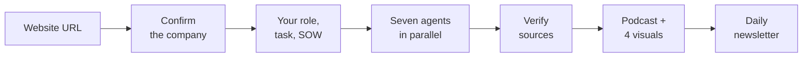

# client-intelligence

**Paste a company's website URL. Get a fact-checked client hub built for your role.**

A Claude plugin marketplace with one plugin, `client-industry-intel`, for consulting teams starting work with a new client. Seven research agents work in parallel, their findings are verified against the sources, and you get a 15-minute podcast plus four visuals tailored to your role, instead of a long document.

**[Framework Guide](https://docs.google.com/document/d/1cRi-vkNXB3iFRfVVwzrIeIPufj6hzb8nigOgNdQGAYo/edit?usp=sharing):** a Google Doc explaining every framework the skill uses.

## Quick start

In Claude Code:

```
/plugin marketplace add Nidhicollab/client-intelligence
/plugin install client-industry-intel@client-intelligence
```

Then ask, for example:

> Build a client hub for https://www.duke-energy.com

## What you give it

| Input | Required |
|---|---|
| The company's website URL | Yes |
| Your role (one of five) | Yes |
| 2 or 3 lines on what you've been asked to build or change | Yes |
| Project or idea focus | Yes |
| The client's proposal and SOW | Optional; read on your machine and never sent to web search |

## What you get

Everyone gets the podcast first. The other four outputs depend on your role.

| Role | 1 | 2 | 3 | 4 | 5 |
|---|---|---|---|---|---|
| **Product manager** | 15-min podcast | Opportunity tree | Customer and stakeholder map | Competitor landscape | Hypothesis and experiment cards |
| **Engineering lead or architect** | 15-min podcast | Current tech landscape | Data flow and integration diagram | Technical risk heatmap | Build-vs-buy vendor grid |
| **UX or product designer** | 15-min podcast | Persona cards | Customer journey map | Service blueprint | Competitor experience teardown |
| **Engagement lead or partner** | 15-min podcast | Stakeholder power and interest map | SOW scope against client priorities | SPEED-C timeline | Meeting prep card |
| **Business or data analyst** | 15-min podcast | KPI dashboard against benchmarks | Metric tree | Data source map | Financial trend charts |

Everything lands in `clients/<company>/hub.html`, one page with a tab per output plus **Signals** and **Sources** tabs. Diagrams can also be copied to a **Miro** board.

## How it works



| Step | What happens |
|---|---|
| **1. URL** | Reads the company's site and works out the entity, industry, segments and careers page. |
| **2. Confirm** | Checks each fact against an independent source; you correct anything before research starts. |
| **3. About you** | Your role, task, focus, and optional proposal and SOW. |
| **4. Research** | Seven agents search at the same time. |
| **5. Verify** | Re-checks the key sources and flags conflicts, including where the SOW and public evidence disagree. |
| **6. Outputs** | Podcast, four role visuals, optional Miro board. |
| **7. Newsletter** | Optional daily email or Slack message with what's new in the last 24 hours. |

## The seven research agents

| Agent | What it does | Framework it applies |
|---|---|---|
| **1. Company & Financials** | Business model, segments, latest results and strategy, benchmarked on industry KPIs. | Industry KPI library |
| **2. Investor & Market** | Stock against its sector, valuation, analyst ratings, earnings-call themes. Public companies only. | Bull and bear cases |
| **3. Industry & Funding** | How the industry evolved, innovations, market size, VC and PE flows. | Industry evolution, VC funding radar |
| **4. Customers & Segments** | Customer buckets, needs, revenue share, roles, switching costs. | Buyer vs. user vs. influencer |
| **5. Competitors** | Competitors classified with evidence, their moves and threat. | Incumbent / Adjacent / Insurgent |
| **6. SPEED-C & Regulation** | Forces acting on the company, rated tailwind or headwind. | SPEED-C |
| **7. Signals** | Open roles from the official careers page, public LinkedIn posts by the company's people, and news TL;DRs from RSS and industry press. | Hiring as a spending signal |

Each role adds its own research asks. For example, the engineering lead's run counts the tools named in job posts, and the designer's run pulls app store ratings.

## Frameworks inside the plugin

For the detail behind each framework, read the [Framework Guide](https://docs.google.com/document/d/1cRi-vkNXB3iFRfVVwzrIeIPufj6hzb8nigOgNdQGAYo/edit?usp=sharing) (Google Doc).

### Competitor classification

| Type | Definition |
|---|---|
| **Incumbent** | A direct peer with the same business model. |
| **Adjacent** | A company from a neighboring industry that can reach the same customer need. |
| **Insurgent** | A startup or new business model attacking the value chain. |

### SPEED-C

| Letter | Driver |
|---|---|
| **S** | Societal |
| **P** | Political (including pending legislation and regulator rulings) |
| **E** | Economic |
| **E** | Environmental |
| **D** | Demographic |
| **C** | Competitive |

### Industry KPI library

| Industry | Example KPIs |
|---|---|
| **Utilities** | Rate base growth, allowed ROE, O&M per customer, SAIDI/SAIFI, load growth, customer satisfaction |
| **SaaS** | ARR, net revenue retention (NRR), CAC payback, gross margin |
| **Banking and auto finance** | Net interest margin (NIM), charge-offs, penetration rate |
| **Retail** | Same-store sales, inventory turns |
| **Any industry** | NPS, where disclosed |

## Evidence standard

Every finding is one record with a claim, metric, source (title, link, date), evidence type, confidence, interpretation and open question.

- Evidence types: filing, earnings, regulator, company, website, research, news, sentiment, and client document.
- Claims found only on the company's website are labeled company claims unless an independent source confirms them.
- Anything from the proposal or SOW is marked confidential, and the hub shows a "Contains confidential client material" badge.
- Missing data is labeled "not publicly available", with the closest proxy named. It is never guessed.

## Daily newsletter

At the end of a run, the skill offers a daily newsletter covering only the last 24 hours: news TL;DRs, posts by the company's people, and new roles on the official careers page, with a line on what they mean for your role. It never includes content from your client documents.

Delivery needs Gmail or Slack connected to Claude. Your address or channel is stored only in your own scheduled task.

## Requirements

| Feature | Needs |
|---|---|
| Install | Claude Code with git |
| Research | Web search |
| Podcast audio | A Mac (built-in voice), or an `OPENAI_API_KEY` or `ELEVENLABS_API_KEY` for two-host audio. Otherwise you get the script. |
| Hub diagrams and charts | An internet connection when you open the hub |
| Miro board | The Miro connector (optional) |
| Daily newsletter | The Gmail or Slack connector |

## Transformation frameworks to apply next

The plugin does not run these. They are the frameworks a PM applies to the hub afterward to turn the research into a point of view.

| Framework | What it shows |
|---|---|
| **Waves of Change** | Whether this is infrastructure, operating-model or business-model change |
| **Capability map** | Readiness across 12 capabilities, and the top gaps |
| **Transformation touchstones** | A five-dimension maturity check |
| **Kotter's Accelerate** | A change-leadership plan |
| **Business Portfolio Map** | Core versus edge bets |
| **Lean Startup** | Hypotheses turned into experiments |

## Repository layout

```
.claude-plugin/marketplace.json
plugins/client-industry-intel/
  .claude-plugin/plugin.json
  skills/client-industry-intel/
    SKILL.md            the flow
    roles/              one file per role
    outputs/            podcast, hub, Miro and newsletter guides
    templates/hub.html  the hub layout
    scripts/            build_hub.py, make_podcast.py
tests/                  python3 -m unittest discover -s tests
```

## Portability

`SKILL.md` is plain markdown with YAML frontmatter, and the scripts use only the Python standard library.

- Claude Code and Cowork load it through this marketplace.
- Agent tools that read `SKILL.md`, such as Codex CLI and Cursor, can use the same folder with their own marketplace or config file.

## License

MIT
