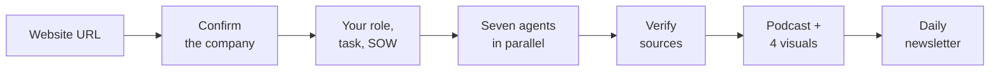

# client-industry-intel v2 Implementation Plan

> **For agentic workers:** REQUIRED SUB-SKILL: Use superpowers:subagent-driven-development (recommended) or superpowers:executing-plans to implement this plan task-by-task. Steps use checkbox (`- [ ]`) syntax for tracking.

**Goal:** Rebuild the `client-industry-intel` skill so it starts from a company URL, asks for the user's role and project context, and produces a 15-minute podcast plus four role-specific visuals in a local HTML hub, with an optional Miro board and a daily newsletter.

**Architecture:** `SKILL.md` holds the flow and points to supporting files that Claude opens only when a step needs them: one file per role, one guide per output, an HTML template, and two Python scripts. The scripts do the work that must be exact every time: `build_hub.py` validates a `hub.json` file and renders it into the template, and `make_podcast.py` turns a podcast script into audio with the Mac voice or a text-to-speech service.

**Tech Stack:** Markdown skill files; Python 3 standard library only (no pip installs); HTML with Mermaid 10.9.1 and Chart.js 4.4.1 from jsDelivr; macOS `say` and `afconvert`; OpenAI and ElevenLabs speech APIs over HTTPS; tests with `python3 -m unittest`.

**Spec:** `docs/superpowers/specs/2026-10-23-role-tailored-outputs-design.md`

## Global Constraints

- Skill folder (written `S/` below): `plugins/client-industry-intel/skills/client-industry-intel/`
- Python: standard library only. Peers have `python3` because the plugin install needs git, which on macOS comes with the same Command Line Tools.
- Role slugs, exactly: `product-manager`, `engineering-lead`, `ux-designer`, `engagement-lead`, `data-analyst`.
- Visual kinds, exactly: `mermaid`, `chart`, `cards`, `table`.
- Evidence types: `filing`, `earnings`, `regulator`, `company`, `research`, `news`, `sentiment`, `website`, `client_document`.
- Client document content is never placed in a web search query, an agent prompt, or the newsletter.
- No email address may appear in any file under `plugins/`.
- Podcast target: about 2,200 words, 13 to 17 minutes at 150 words per minute.
- Hub folder: `clients/<company-slug>/` in the user's working directory.
- CDN links pinned to exact versions: `https://cdn.jsdelivr.net/npm/mermaid@10.9.1/dist/mermaid.min.js`, `https://cdn.jsdelivr.net/npm/chart.js@4.4.1/dist/chart.umd.min.js`.
- Plugin version after release: `2.0.0`.
- Commit messages end with `Co-Authored-By: Claude Opus 5.5 <noreply@anthropic.com>`. Do not push; the user decides when to push.

## Review Focus

1. Fetched web text containing HTML or script tags in a claim: the hub must show it as plain text and never run it. Pinned by `test_template_never_uses_innerHTML` and `test_build_escapes_script_close` (Task 1).
2. A `javascript:` or other non-web link in `source_url` or `miro_url`: validation must reject it so the hub never renders a clickable script link. Pinned by `test_rejects_javascript_source_url` (Task 1).
3. A record from the SOW while the hub's `confidential` flag is false: validation must refuse, so the badge always appears. Pinned by `test_confidential_record_requires_confidential_hub` (Task 1).
4. A podcast script far shorter or longer than 15 minutes: the script tool must say so rather than silently produce a 4-minute podcast. Pinned by `test_reports_length_outside_target` (Task 2).
5. A text-to-speech request failing partway (network drop, bad key): the run must still finish with Mac audio or the script, and say what happened. Pinned by `test_service_failure_falls_back_to_mac` (Task 2).

## File map

| File | Responsibility | Task |
|---|---|---|
| `S/scripts/build_hub.py` | Validate `hub.json`; render it into the template | 1 |
| `S/templates/hub.html` | Fixed hub layout; renders the embedded JSON safely | 1 |
| `tests/test_build_hub.py`, `tests/fixtures/sample-hub.json` | Hub tests and a valid sample | 1 |
| `.gitignore` | Keep `clients/` output (may hold confidential material) out of git | 1 |
| `S/scripts/make_podcast.py` | Parse script, pick voice mode, make audio, fall back | 2 |
| `tests/test_make_podcast.py` | Podcast tests | 2 |
| `S/roles/*.md` (5 files) | Research asks, four outputs, podcast segment per role | 3 |
| `tests/test_skill_files.py` | Structure and privacy checks for skill files | 3, 4, 6, 7 |
| `S/outputs/podcast.md`, `hub.md`, `miro.md` | How to make each output | 4 |
| `S/outputs/newsletter.md` | Daily newsletter setup and the daily task prompt | 5 |
| `S/SKILL.md` | The flow | 6 |
| `plugin.json`, `marketplace.json`, `README.md` | Release | 7 |
| `tests/fixtures/dummy-sow.md` | Fictional SOW for end-to-end runs | 8 |

Run all tests from the repo root with: `python3 -m unittest discover -s tests -v`

---

### Task 1: Hub builder and template

**Files:**
- Create: `S/scripts/build_hub.py`
- Create: `S/templates/hub.html`
- Create: `tests/test_build_hub.py`
- Create: `tests/fixtures/sample-hub.json`
- Create: `.gitignore`
- Modify: `docs/superpowers/specs/2026-10-23-role-tailored-outputs-design.md` (file structure and evidence record sections)

**Interfaces:**
- Consumes: nothing.
- Produces:
  - `build_hub.ROLES: dict[str, str]` (slug to label)
  - `build_hub.validate(data: dict) -> list[str]` (empty list means valid)
  - `build_hub.build(data: dict, template: str) -> str`
  - `build_hub.main(argv: list[str] | None) -> int`, CLI: `python3 S/scripts/build_hub.py <hub.json> <out.html> [--template PATH]`
  - The `hub.json` schema below, used by Tasks 4, 6 and 8.

`hub.json` schema:

```json
{
  "company": "string, required",
  "as_of": "YYYY-MM-DD, required",
  "role": "one of the five role slugs, required",
  "role_label": "optional; filled from ROLES if missing",
  "confidential": "true or false, required; true if any record is confidential",
  "miro_url": "https URL or null",
  "notes": ["short strings shown under the title, e.g. 'Miro not connected, so no board was made.'"],
  "podcast": {"audio": "file name next to hub.html, or null", "script": "podcast-script.md", "voice": "mac | openai | elevenlabs | script", "minutes": 15.1, "notes": ["..."]},
  "outputs": [
    {"id": "lowercase-slug", "title": "string", "status": "complete", "so_what": "two sentences", "visual": {"kind": "mermaid", "code": "flowchart TD ..."}, "caption": "optional", "evidence": ["r001"]},
    {"id": "...", "title": "...", "status": "incomplete", "reason": "why it is incomplete"}
  ],
  "signals": {"see Task 6, Signals output": "object"},
  "records": [{"id": "r001", "claim": "...", "evidence_type": "filing", "confidence": "high", "source_url": "https://...", "...": "other evidence record fields"}]
}
```

Visual shapes:
- `{"kind": "mermaid", "code": "<mermaid source>"}`
- `{"kind": "chart", "config": {<Chart.js config object>}}`
- `{"kind": "cards", "cards": [{"title": "...", "subtitle": "optional", "body": ["line", "line"], "tags": ["optional"]}]}`
- `{"kind": "table", "columns": ["A", "B"], "rows": [["text", {"text": "High", "level": "high"}]]}` where `level` is `high`, `medium` or `low` and colors the cell.

- [ ] **Step 1: Record the spec changes this task introduces**

In the spec's "File structure" block, replace the line `make_podcast.sh                 Mac voice or text-to-speech service` with these two lines:

```
      make_podcast.py                 Mac voice or text-to-speech service
      build_hub.py                    validates hub.json and renders the hub
```

In the spec, replace every other occurrence of `scripts/make_podcast.sh` with `scripts/make_podcast.py`.

In the spec's "6. Evidence records" list, add a third bullet:

```
- A new string field, `id` (`r001`, `r002`, ...), assigned when the records are merged, so outputs can point to the records behind them.
```

Under "## Open items to verify during implementation", add a paragraph:

```
Implementation notes: the scripts are Python (standard library only) rather than shell, because chunking text for the speech services and validating the hub data are unreliable in shell. Peers already have `python3` because the plugin install requires git.
```

- [ ] **Step 2: Add `.gitignore`**

Create `.gitignore` at the repo root:

```
# Skill output can contain confidential client material
clients/
__pycache__/
```

- [ ] **Step 3: Write the sample fixture**

Create `tests/fixtures/sample-hub.json`:

```json
{
  "company": "Example Energy Co.",
  "as_of": "2026-10-23",
  "role": "product-manager",
  "confidential": true,
  "miro_url": null,
  "notes": ["Miro not connected, so no board was made."],
  "podcast": {"audio": "podcast.m4a", "script": "podcast-script.md", "voice": "mac", "minutes": 14.8, "notes": []},
  "outputs": [
    {
      "id": "opportunity-tree",
      "title": "Opportunity tree",
      "status": "complete",
      "so_what": "Outage response is the biggest opportunity. Two of three hypotheses depend on field data the client has not shared.",
      "visual": {"kind": "mermaid", "code": "flowchart TD\n  A[Cut outage minutes] --> B[Slow crew dispatch]\n  B --> H1[H1: Mobile dispatch cuts response time]"},
      "evidence": ["r001", "r004"]
    },
    {
      "id": "stakeholder-map",
      "title": "Customer and stakeholder map",
      "status": "complete",
      "so_what": "Residential customers drive volume. Industrial buyers drive margin.",
      "visual": {"kind": "table", "columns": ["Segment", "Buyer", "Share"], "rows": [["Residential", "Homeowner", {"text": "High", "level": "high"}], ["Industrial", "Plant manager", "Medium"]]},
      "evidence": ["r002"]
    },
    {
      "id": "competitors",
      "title": "Competitor landscape",
      "status": "complete",
      "so_what": "Insurgents are winning on software, not price.",
      "visual": {"kind": "chart", "config": {"type": "bar", "data": {"labels": ["Incumbent", "Adjacent", "Insurgent"], "datasets": [{"label": "Competitors found", "data": [4, 3, 5]}]}}},
      "evidence": ["r003"]
    },
    {
      "id": "experiments",
      "title": "Hypothesis and experiment cards",
      "status": "incomplete",
      "reason": "The customers agent did not return results."
    }
  ],
  "signals": {
    "checked": "2026-10-23",
    "hiring": {"status": "ok", "careers_url": "https://example.com/careers", "board_url": null, "total_open": 42, "groups": [{"dimension": "team", "name": "Engineering", "count": 12}], "skills": [{"name": "Python", "count": 6}], "notable_roles": [{"title": "Head of Grid Software", "team": "Engineering", "location": "Charlotte, NC", "url": "https://example.com/careers/123"}]},
    "posts": [{"author": "Jane Doe", "author_title": "VP Operations", "date": "2026-10-20", "summary": "Announced a new field operations hub.", "url": "https://www.linkedin.com/posts/example"}],
    "news": [{"title": "Example Energy files rate case", "outlet": "Utility Dive", "date": "2026-10-18", "tldr": "Asks for a 6% rate increase to fund grid upgrades.", "url": "https://example.com/news/1", "paywalled": false}]
  },
  "records": [
    {"id": "r001", "section": "company", "claim": "Average outage duration rose year over year.", "entity": "Example Energy Co.", "metric": "142 minutes SAIDI, FY2025", "source_title": "FY2025 10-K", "source_url": "https://example.com/10k", "source_date": "2026-02-20", "evidence_type": "filing", "confidence": "high", "interpretation": "Reliability is under regulator scrutiny.", "open_question": null, "confidential": false},
    {"id": "r002", "section": "customers", "claim": "Residential customers are 85% of accounts.", "entity": "Example Energy Co.", "metric": "85% of accounts, FY2025", "source_title": "Investor deck", "source_url": "https://example.com/deck", "source_date": "2026-05-01", "evidence_type": "company", "confidence": "medium", "interpretation": "Volume sits with residential.", "open_question": null, "confidential": false},
    {"id": "r003", "section": "competitors", "claim": "Three grid-software startups raised Series B rounds this year.", "entity": "Sector", "metric": null, "source_title": "Trade press roundup", "source_url": "https://example.com/news/2", "source_date": "2026-09-01", "evidence_type": "news", "confidence": "medium", "interpretation": "Insurgents are funded.", "open_question": null, "confidential": false},
    {"id": "r004", "section": "company", "claim": "The SOW targets a 20% cut in dispatch time.", "entity": "Example Energy Co.", "metric": "20% reduction", "source_title": "Client SOW", "source_url": "SOW.pdf", "source_date": "2026-10-01", "evidence_type": "client_document", "confidence": "high", "interpretation": "Defines success for the engagement.", "open_question": "Baseline dispatch time?", "confidential": true}
  ]
}
```

- [ ] **Step 4: Write the failing tests**

Create `tests/test_build_hub.py`:

```python
import copy
import json
import sys
import tempfile
import unittest
from pathlib import Path

ROOT = Path(__file__).resolve().parent.parent
SKILL = ROOT / "plugins" / "client-industry-intel" / "skills" / "client-industry-intel"
sys.path.insert(0, str(SKILL / "scripts"))

import build_hub  # noqa: E402

FIXTURE = Path(__file__).parent / "fixtures" / "sample-hub.json"
TEMPLATE = SKILL / "templates" / "hub.html"
DATA_OPEN = '<script id="hub-data" type="application/json">'


def sample():
    return json.loads(FIXTURE.read_text(encoding="utf-8"))


def has_error(errors, text):
    return any(text in e for e in errors)


class ValidateTests(unittest.TestCase):
    def test_sample_is_valid(self):
        self.assertEqual(build_hub.validate(sample()), [])

    def test_rejects_unknown_role(self):
        d = sample()
        d["role"] = "sales"
        self.assertTrue(has_error(build_hub.validate(d), "role"))

    def test_requires_exactly_four_outputs(self):
        d = sample()
        d["outputs"] = d["outputs"][:3]
        self.assertTrue(has_error(build_hub.validate(d), "exactly 4"))

    def test_rejects_javascript_source_url(self):
        d = sample()
        d["records"][0]["source_url"] = "javascript:alert(1)"
        self.assertTrue(has_error(build_hub.validate(d), "source_url"))
        d = sample()
        d["miro_url"] = "javascript:alert(1)"
        self.assertTrue(has_error(build_hub.validate(d), "miro_url"))

    def test_client_document_must_be_confidential(self):
        d = sample()
        d["records"][3]["confidential"] = False
        self.assertTrue(has_error(build_hub.validate(d), "must be confidential"))

    def test_confidential_record_requires_confidential_hub(self):
        d = sample()
        d["confidential"] = False
        self.assertTrue(has_error(build_hub.validate(d), "confidential flag must be true"))

    def test_complete_output_needs_known_evidence(self):
        d = sample()
        d["outputs"][0]["evidence"] = ["r999"]
        self.assertTrue(has_error(build_hub.validate(d), "unknown record"))
        d = sample()
        d["outputs"][0]["evidence"] = []
        self.assertTrue(has_error(build_hub.validate(d), "at least one evidence"))

    def test_incomplete_output_needs_reason(self):
        d = sample()
        del d["outputs"][3]["reason"]
        self.assertTrue(has_error(build_hub.validate(d), "reason"))

    def test_table_rows_must_match_columns(self):
        d = sample()
        d["outputs"][1]["visual"]["rows"][0] = ["only one cell"]
        self.assertTrue(has_error(build_hub.validate(d), "must have 3 cells"))
        d = sample()
        d["outputs"][1]["visual"]["rows"][0][2] = {"text": "x", "level": "extreme"}
        self.assertTrue(has_error(build_hub.validate(d), "invalid level"))

    def test_rejects_reserved_or_bad_output_id(self):
        d = sample()
        d["outputs"][0]["id"] = "signals"
        self.assertTrue(has_error(build_hub.validate(d), "reserved"))
        d = sample()
        d["outputs"][0]["id"] = "Has Spaces"
        self.assertTrue(has_error(build_hub.validate(d), "lowercase"))

    def test_podcast_audio_must_be_local_file(self):
        d = sample()
        d["podcast"]["audio"] = "https://evil.example/a.mp3"
        self.assertTrue(has_error(build_hub.validate(d), "podcast.audio"))

    def test_rejects_unknown_visual_kind(self):
        d = sample()
        d["outputs"][0]["visual"] = {"kind": "image", "src": "x.png"}
        self.assertTrue(has_error(build_hub.validate(d), "visual.kind"))


class BuildTests(unittest.TestCase):
    def template(self):
        return TEMPLATE.read_text(encoding="utf-8")

    def embedded(self, html):
        return json.loads(html.split(DATA_OPEN, 1)[1].split("</script>", 1)[0])

    def test_build_injects_data_and_role_label(self):
        html = build_hub.build(sample(), self.template())
        self.assertNotIn(build_hub.PLACEHOLDER, html)
        data = self.embedded(html)
        self.assertEqual(data["company"], "Example Energy Co.")
        self.assertEqual(data["role_label"], "Product manager")

    def test_build_escapes_script_close(self):
        d = sample()
        evil = "</script><script>alert(1)</script><!-- x"
        d["records"][0]["claim"] = evil
        html = build_hub.build(d, self.template())
        self.assertNotIn("</script><script>alert(1)", html)
        self.assertEqual(self.embedded(html)["records"][0]["claim"], evil)

    def test_build_requires_placeholder(self):
        with self.assertRaises(ValueError):
            build_hub.build(sample(), "<html>no placeholder</html>")

    def test_template_never_uses_innerHTML(self):
        self.assertNotIn("innerHTML", self.template())
        self.assertNotIn("insertAdjacentHTML", self.template())
        self.assertNotIn("document.write", self.template())

    def test_template_pins_cdn_versions(self):
        t = self.template()
        self.assertIn("https://cdn.jsdelivr.net/npm/mermaid@10.9.1/dist/mermaid.min.js", t)
        self.assertIn("https://cdn.jsdelivr.net/npm/chart.js@4.4.1/dist/chart.umd.min.js", t)
        self.assertIn('securityLevel: "strict"', t)

    def test_main_writes_file_and_rejects_invalid(self):
        with tempfile.TemporaryDirectory() as tmp:
            out = Path(tmp) / "hub.html"
            self.assertEqual(build_hub.main([str(FIXTURE), str(out)]), 0)
            self.assertIn("Example Energy Co.", out.read_text(encoding="utf-8"))
            bad = Path(tmp) / "bad.json"
            d = sample()
            d["role"] = "sales"
            bad.write_text(json.dumps(d), encoding="utf-8")
            self.assertEqual(build_hub.main([str(bad), str(Path(tmp) / "bad.html")]), 1)
            self.assertFalse((Path(tmp) / "bad.html").exists())


if __name__ == "__main__":
    unittest.main()
```

- [ ] **Step 5: Run the tests to verify they fail**

Run: `python3 -m unittest tests.test_build_hub -v`
Expected: ERROR with `ModuleNotFoundError: No module named 'build_hub'`

- [ ] **Step 6: Write `build_hub.py`**

Create `S/scripts/build_hub.py`:

```python
#!/usr/bin/env python3
"""Validate a hub.json file and render it into the client hub HTML template.

Usage: python3 build_hub.py <hub.json> <out.html> [--template PATH]
Exits 1 and prints every problem if the data is invalid; nothing is written.
"""
import argparse
import json
import re
import sys
from pathlib import Path

ROLES = {
    "product-manager": "Product manager",
    "engineering-lead": "Engineering lead or architect",
    "ux-designer": "UX or product designer",
    "engagement-lead": "Engagement lead or partner",
    "data-analyst": "Business or data analyst",
}
EVIDENCE_TYPES = {
    "filing", "earnings", "regulator", "company", "research",
    "news", "sentiment", "website", "client_document",
}
CONFIDENCE = {"high", "medium", "low"}
LEVELS = {"high", "medium", "low"}
VISUAL_KINDS = {"mermaid", "chart", "cards", "table"}
RESERVED_IDS = {"podcast", "signals", "sources"}
PLACEHOLDER = "__HUB_DATA__"
DEFAULT_TEMPLATE = Path(__file__).resolve().parent.parent / "templates" / "hub.html"
DATE_RE = re.compile(r"^\d{4}-\d{2}-\d{2}$")
URL_RE = re.compile(r"^https?://", re.IGNORECASE)
ID_RE = re.compile(r"^[a-z0-9]+(?:-[a-z0-9]+)*$")


def _visual_errors(where, visual):
    if not isinstance(visual, dict) or visual.get("kind") not in VISUAL_KINDS:
        return [f"{where}: visual.kind must be one of {sorted(VISUAL_KINDS)}"]
    kind = visual["kind"]
    if kind == "mermaid":
        if not isinstance(visual.get("code"), str) or not visual["code"].strip():
            return [f"{where}: mermaid visual needs non-empty 'code'"]
    elif kind == "chart":
        if not isinstance(visual.get("config"), dict):
            return [f"{where}: chart visual needs a 'config' object"]
    elif kind == "cards":
        cards = visual.get("cards")
        if not isinstance(cards, list) or not cards:
            return [f"{where}: cards visual needs a non-empty 'cards' list"]
        return [
            f"{where}: card {i} needs a 'title'"
            for i, card in enumerate(cards)
            if not isinstance(card, dict) or not card.get("title")
        ]
    elif kind == "table":
        columns, rows = visual.get("columns"), visual.get("rows")
        if not isinstance(columns, list) or not columns or not isinstance(rows, list):
            return [f"{where}: table visual needs 'columns' and 'rows' lists"]
        errors = []
        for i, row in enumerate(rows):
            if not isinstance(row, list) or len(row) != len(columns):
                errors.append(f"{where}: table row {i} must have {len(columns)} cells")
                continue
            for cell in row:
                if isinstance(cell, dict) and cell.get("level") not in (None, *LEVELS):
                    errors.append(f"{where}: table row {i} has invalid level {cell.get('level')!r}")
        return errors
    return []


def _record_errors(data, records):
    errors, ids = [], set()
    for i, rec in enumerate(records):
        where = f"record {i}"
        if not isinstance(rec, dict):
            errors.append(f"{where}: must be an object")
            continue
        rid = rec.get("id")
        if not isinstance(rid, str) or not rid:
            errors.append(f"{where}: needs an 'id'")
        elif rid in ids:
            errors.append(f"{where}: duplicate id {rid!r}")
        else:
            ids.add(rid)
        if not rec.get("claim"):
            errors.append(f"{where}: needs a 'claim'")
        etype = rec.get("evidence_type")
        if etype not in EVIDENCE_TYPES:
            errors.append(f"{where}: invalid evidence_type {etype!r}")
        if rec.get("confidence") not in CONFIDENCE:
            errors.append(f"{where}: confidence must be high, medium or low")
        if etype == "client_document":
            if rec.get("confidential") is not True:
                errors.append(f"{where}: client_document records must be confidential")
        elif not URL_RE.match(str(rec.get("source_url") or "")):
            errors.append(f"{where}: source_url must start with http:// or https://")
        if rec.get("confidential") is True and data.get("confidential") is False:
            errors.append(f"{where}: is confidential, so the hub's confidential flag must be true")
    return errors, ids


def _output_errors(outputs, record_ids):
    errors, seen = [], set()
    for i, out in enumerate(outputs):
        where = f"output {i + 2}"
        if not isinstance(out, dict):
            errors.append(f"{where}: must be an object")
            continue
        oid = out.get("id")
        if not isinstance(oid, str) or not ID_RE.match(oid):
            errors.append(f"{where}: id must be a lowercase-hyphenated slug")
        elif oid in RESERVED_IDS:
            errors.append(f"{where}: id {oid!r} is reserved")
        elif oid in seen:
            errors.append(f"{where}: duplicate id {oid!r}")
        else:
            seen.add(oid)
        if not out.get("title"):
            errors.append(f"{where}: needs a 'title'")
        status = out.get("status")
        if status == "incomplete":
            if not out.get("reason"):
                errors.append(f"{where}: incomplete outputs need a 'reason'")
        elif status == "complete":
            if not out.get("so_what"):
                errors.append(f"{where}: needs a 'so_what'")
            errors.extend(_visual_errors(where, out.get("visual")))
            evidence = out.get("evidence")
            if not isinstance(evidence, list) or not evidence:
                errors.append(f"{where}: needs at least one evidence record id")
            else:
                errors.extend(
                    f"{where}: unknown record id {rid!r}" for rid in evidence if rid not in record_ids
                )
        else:
            errors.append(f"{where}: status must be 'complete' or 'incomplete'")
    return errors


def validate(data):
    """Return a list of problems with the hub data. An empty list means it is valid."""
    if not isinstance(data, dict):
        return ["hub data must be a JSON object"]
    errors = []
    if not isinstance(data.get("company"), str) or not data["company"].strip():
        errors.append("company must be a non-empty string")
    if not isinstance(data.get("as_of"), str) or not DATE_RE.match(data["as_of"]):
        errors.append("as_of must be a YYYY-MM-DD date")
    if data.get("role") not in ROLES:
        errors.append(f"role must be one of {sorted(ROLES)}")
    if not isinstance(data.get("confidential"), bool):
        errors.append("confidential must be true or false")
    miro = data.get("miro_url")
    if miro is not None and not URL_RE.match(str(miro)):
        errors.append("miro_url must start with http:// or https://, or be null")
    podcast = data.get("podcast")
    if not isinstance(podcast, dict):
        errors.append("podcast must be an object")
    else:
        audio = podcast.get("audio")
        if audio is not None and (not isinstance(audio, str) or ":" in audio or "/" in audio or "\\" in audio):
            errors.append("podcast.audio must be a file name next to hub.html, or null")
    if not isinstance(data.get("signals"), dict):
        errors.append("signals must be an object")

    records = data.get("records")
    if not isinstance(records, list):
        errors.append("records must be a list")
        records = []
    record_errors, record_ids = _record_errors(data, records)
    errors.extend(record_errors)

    outputs = data.get("outputs")
    if not isinstance(outputs, list) or len(outputs) != 4:
        errors.append("outputs must be a list of exactly 4 items")
    if isinstance(outputs, list):
        errors.extend(_output_errors(outputs, record_ids))
    return errors


def build(data, template):
    """Return the template with the hub data embedded as safe JSON."""
    if PLACEHOLDER not in template:
        raise ValueError(f"template is missing {PLACEHOLDER}")
    data = dict(data)
    data.setdefault("role_label", ROLES.get(data.get("role"), ""))
    payload = json.dumps(data, ensure_ascii=False)
    # Stop text inside the data from closing the <script> block it lives in.
    payload = payload.replace("</", "<\\/").replace("<!--", "<\\u0021--")
    return template.replace(PLACEHOLDER, payload)


def main(argv=None):
    parser = argparse.ArgumentParser(description="Validate hub.json and render the client hub.")
    parser.add_argument("data", help="path to hub.json")
    parser.add_argument("out", help="path to write hub.html")
    parser.add_argument("--template", default=str(DEFAULT_TEMPLATE))
    args = parser.parse_args(argv)
    try:
        data = json.loads(Path(args.data).read_text(encoding="utf-8"))
    except (OSError, json.JSONDecodeError) as exc:
        print(f"error: cannot read {args.data}: {exc}", file=sys.stderr)
        return 1
    errors = validate(data)
    if errors:
        for error in errors:
            print(f"error: {error}", file=sys.stderr)
        return 1
    template = Path(args.template).read_text(encoding="utf-8")
    Path(args.out).write_text(build(data, template), encoding="utf-8")
    print(args.out)
    return 0


if __name__ == "__main__":
    sys.exit(main())
```

- [ ] **Step 7: Write the template**

Create `S/templates/hub.html`:

```html
<!doctype html>
<html lang="en">
<head>
<meta charset="utf-8">
<meta name="viewport" content="width=device-width, initial-scale=1">
<title>Client hub</title>
<style>
:root{--bg:#ffffff;--fg:#1b1b1f;--muted:#5f6368;--line:#dadce0;--panel:#f6f7f9;--accent:#1a56db;--warn:#b3261e;--high:#f6d1cd;--medium:#fbe9b7;--low:#d6ecd9}
@media (prefers-color-scheme:dark){:root{--bg:#141417;--fg:#e8eaed;--muted:#9aa0a6;--line:#3c4043;--panel:#1f1f23;--accent:#8ab4f8;--warn:#f28b82;--high:#5b2a27;--medium:#584718;--low:#233d29}}
*{box-sizing:border-box}
[hidden]{display:none!important}
body{margin:0;background:var(--bg);color:var(--fg);font:15px/1.55 -apple-system,BlinkMacSystemFont,"Segoe UI",Roboto,sans-serif}
.wrap{max-width:1100px;margin:0 auto;padding:0 16px}
header{border-bottom:1px solid var(--line);padding:20px 0 12px}
h1{margin:0 0 4px;font-size:1.6rem}
.muted{color:var(--muted)}
.badge{display:inline-block;margin:8px 0 0;padding:2px 10px;border:1px solid var(--warn);border-radius:999px;color:var(--warn);font-weight:600;font-size:.85rem}
nav{display:flex;flex-wrap:wrap;gap:4px;padding:12px 0;border-bottom:1px solid var(--line)}
nav button{font:inherit;padding:6px 12px;border:1px solid var(--line);border-radius:6px;background:var(--panel);color:var(--fg);cursor:pointer}
nav button[aria-selected="true"]{border-color:var(--accent);color:var(--accent);font-weight:600}
section{padding:20px 0 40px}
.sowhat{font-size:1.05rem;border-left:3px solid var(--accent);padding-left:12px}
.cards{display:grid;grid-template-columns:repeat(auto-fill,minmax(260px,1fr));gap:12px}
.card{border:1px solid var(--line);border-radius:8px;padding:12px;background:var(--panel)}
.card h3{margin:0 0 4px;font-size:1rem}
.tablewrap{overflow-x:auto}
table{border-collapse:collapse;width:100%;font-size:.92rem}
th,td{border:1px solid var(--line);padding:6px 8px;text-align:left;vertical-align:top}
th{background:var(--panel)}
.lvl-high{background:var(--high)}.lvl-medium{background:var(--medium)}.lvl-low{background:var(--low)}
.chart{position:relative;max-width:900px;height:380px}
.mermaid{background:var(--panel);border-radius:8px;padding:12px;overflow-x:auto}
.evidence li{margin:6px 0}
.tag{font-size:.82rem;color:var(--muted)}
.tag.warn{color:var(--warn)}
audio{width:100%;max-width:600px}
a{color:var(--accent)}
</style>
<script src="https://cdn.jsdelivr.net/npm/mermaid@10.9.1/dist/mermaid.min.js"></script>
<script src="https://cdn.jsdelivr.net/npm/chart.js@4.4.1/dist/chart.umd.min.js"></script>
</head>
<body>
<div class="wrap">
<header>
<h1 id="company"></h1>
<div id="meta" class="muted"></div>
<div id="badge" class="badge" hidden>Contains confidential client material</div>
<ul id="notes" class="muted"></ul>
</header>
<nav id="tabs" role="tablist"></nav>
<main id="panels"></main>
</div>
<script id="hub-data" type="application/json">__HUB_DATA__</script>
<script>
(function () {
  var data = JSON.parse(document.getElementById("hub-data").textContent);

  if (window.mermaid) {
    window.mermaid.initialize({
      startOnLoad: false,
      securityLevel: "strict",
      theme: window.matchMedia("(prefers-color-scheme: dark)").matches ? "dark" : "default"
    });
  }

  function el(tag, cls, text) {
    var e = document.createElement(tag);
    if (cls) e.className = cls;
    if (text !== undefined && text !== null) e.textContent = String(text);
    return e;
  }
  function safeUrl(u) { return typeof u === "string" && /^https?:\/\//i.test(u) ? u : null; }
  function link(u, text) {
    var s = safeUrl(u);
    if (!s) return el("span", null, text);
    var a = el("a", null, text);
    a.href = s; a.target = "_blank"; a.rel = "noopener noreferrer";
    return a;
  }

  var records = {};
  (data.records || []).forEach(function (r) { records[r.id] = r; });

  document.title = data.company + " · client hub";
  document.getElementById("company").textContent = data.company;
  document.getElementById("meta").textContent = "As of " + data.as_of + " · Built for: " + data.role_label;
  if (data.confidential) document.getElementById("badge").hidden = false;
  var notes = document.getElementById("notes");
  (data.notes || []).forEach(function (n) { notes.appendChild(el("li", null, n)); });
  if (safeUrl(data.miro_url)) {
    var miro = el("li");
    miro.append("Miro board: ");
    miro.appendChild(link(data.miro_url, "open the board"));
    notes.appendChild(miro);
  }

  function recordItem(r) {
    var li = el("li");
    li.appendChild(el("span", null, r.claim + " "));
    if (r.metric) li.appendChild(el("strong", null, r.metric + " "));
    if (r.evidence_type === "client_document") li.appendChild(el("span", "tag", "(" + (r.source_title || "client document") + ")"));
    else li.appendChild(link(r.source_url, r.source_title || "source"));
    li.appendChild(el("span", "tag", " · " + r.confidence + " confidence" + (r.source_date ? " · " + r.source_date : "")));
    if (r.confidential) li.appendChild(el("span", "tag warn", " · confidential"));
    if (r.interpretation) li.appendChild(el("div", "tag", r.interpretation));
    return li;
  }
  function evidenceList(ids) {
    var ul = el("ul", "evidence");
    (ids || []).forEach(function (id) { if (records[id]) ul.appendChild(recordItem(records[id])); });
    return ul;
  }
  function table(columns, rows) {
    var wrap = el("div", "tablewrap"), t = el("table"), head = el("tr");
    columns.forEach(function (c) { head.appendChild(el("th", null, c)); });
    t.appendChild(head);
    rows.forEach(function (row) {
      var tr = el("tr");
      row.forEach(function (cell) {
        var o = cell !== null && typeof cell === "object" ? cell : { text: cell === null || cell === undefined ? "" : String(cell) };
        tr.appendChild(el("td", o.level ? "lvl-" + o.level : null, o.text));
      });
      t.appendChild(tr);
    });
    wrap.appendChild(t);
    return wrap;
  }
  function visual(v, after) {
    if (v.kind === "mermaid") {
      var pre = el("pre", "mermaid", v.code);
      after.push(function () {
        if (window.mermaid) window.mermaid.run({ nodes: [pre] });
        else pre.before(el("p", "muted", "Diagrams need an internet connection. The diagram source is shown below."));
      });
      return pre;
    }
    if (v.kind === "chart") {
      var box = el("div", "chart"), canvas = el("canvas");
      box.appendChild(canvas);
      after.push(function () {
        if (window.Chart) new window.Chart(canvas, v.config);
        else box.appendChild(el("p", "muted", "Charts need an internet connection."));
      });
      return box;
    }
    if (v.kind === "cards") {
      var grid = el("div", "cards");
      v.cards.forEach(function (cd) {
        var c = el("div", "card");
        c.appendChild(el("h3", null, cd.title));
        if (cd.subtitle) c.appendChild(el("div", "muted", cd.subtitle));
        var ul = el("ul");
        (cd.body || []).forEach(function (b) { ul.appendChild(el("li", null, b)); });
        c.appendChild(ul);
        if (cd.tags && cd.tags.length) c.appendChild(el("div", "tag", cd.tags.join(" · ")));
        grid.appendChild(c);
      });
      return grid;
    }
    if (v.kind === "table") return table(v.columns, v.rows);
    return el("p", "muted", "Unknown visual type.");
  }

  var tabs = [];
  function addTab(id, title, build) { tabs.push({ id: id, title: title, build: build }); }

  addTab("podcast", "1. Podcast", function (sec) {
    var p = data.podcast || {};
    sec.appendChild(el("h2", null, "Podcast"));
    if (p.audio) {
      var audio = el("audio");
      audio.controls = true; audio.preload = "metadata"; audio.src = p.audio;
      sec.appendChild(audio);
    } else {
      sec.appendChild(el("p", "muted", "No audio for this run. The script is saved next to this file."));
    }
    var info = [];
    if (p.minutes) info.push("About " + p.minutes + " minutes");
    if (p.voice) info.push("Voice: " + p.voice);
    if (p.script) info.push("Script: " + p.script);
    if (info.length) sec.appendChild(el("p", "muted", info.join(" · ")));
    (p.notes || []).forEach(function (n) { sec.appendChild(el("p", "muted", n)); });
  });

  (data.outputs || []).forEach(function (o, i) {
    addTab(o.id, (i + 2) + ". " + o.title, function (sec, after) {
      sec.appendChild(el("h2", null, o.title));
      if (o.status === "incomplete") {
        sec.appendChild(el("p", "badge", "Incomplete: " + (o.reason || "the research for this output did not finish.")));
        return;
      }
      sec.appendChild(el("p", "sowhat", o.so_what));
      sec.appendChild(visual(o.visual, after));
      if (o.caption) sec.appendChild(el("p", "muted", o.caption));
      sec.appendChild(el("h3", null, "Evidence"));
      sec.appendChild(evidenceList(o.evidence));
    });
  });

  addTab("signals", "Signals", function (sec) {
    var s = data.signals || {}, h = s.hiring || {};
    sec.appendChild(el("h2", null, "Signals"));
    if (s.checked) sec.appendChild(el("p", "muted", "Checked " + s.checked));

    sec.appendChild(el("h3", null, "Hiring"));
    if (h.status !== "ok") {
      sec.appendChild(el("p", "muted", h.status === "unreadable"
        ? "The careers page could not be read, so no hiring numbers are shown."
        : "No official careers page was found, so no hiring numbers are shown."));
    } else {
      var line = el("p");
      line.append(h.total_open !== null && h.total_open !== undefined ? h.total_open + " open roles on " : "Open roles on ");
      line.appendChild(link(h.board_url || h.careers_url, "the official careers page"));
      sec.appendChild(line);
      ["team", "location", "seniority"].forEach(function (dim) {
        var rows = (h.groups || []).filter(function (g) { return g.dimension === dim; })
          .map(function (g) { return [g.name, g.count]; });
        if (rows.length) {
          sec.appendChild(el("h4", null, "By " + dim));
          sec.appendChild(table([dim.charAt(0).toUpperCase() + dim.slice(1), "Open roles"], rows));
        }
      });
      if ((h.skills || []).length) {
        sec.appendChild(el("h4", null, "Skills named most often"));
        sec.appendChild(table(["Skill", "Roles naming it"], h.skills.map(function (k) { return [k.name, k.count]; })));
      }
      if ((h.notable_roles || []).length) {
        sec.appendChild(el("h4", null, "Notable roles"));
        var roles = el("ul");
        h.notable_roles.forEach(function (r) {
          var li = el("li");
          li.appendChild(link(r.url, r.title));
          li.append(" · " + [r.team, r.location].filter(Boolean).join(" · "));
          roles.appendChild(li);
        });
        sec.appendChild(roles);
      }
    }

    sec.appendChild(el("h3", null, "Posts by the company's people"));
    if (!(s.posts || []).length) {
      sec.appendChild(el("p", "muted", "No public posts found."));
    } else {
      var posts = el("ul");
      s.posts.forEach(function (p) {
        var li = el("li");
        li.append(p.summary + " ");
        li.appendChild(link(p.url, "— " + p.author + (p.author_title ? ", " + p.author_title : "")));
        if (p.date) li.appendChild(el("span", "tag", " · " + p.date));
        posts.appendChild(li);
      });
      sec.appendChild(posts);
    }

    sec.appendChild(el("h3", null, "News TL;DRs"));
    if (!(s.news || []).length) {
      sec.appendChild(el("p", "muted", "No recent news found."));
    } else {
      var news = el("ul");
      s.news.forEach(function (n) {
        var li = el("li");
        li.appendChild(link(n.url, n.title));
        li.appendChild(el("span", "tag", " · " + [n.outlet, n.date].filter(Boolean).join(" · ") + (n.paywalled ? " · paywalled, headline only" : "")));
        if (n.tldr) li.appendChild(el("div", null, n.tldr));
        news.appendChild(li);
      });
      sec.appendChild(news);
    }
  });

  addTab("sources", "Sources", function (sec) {
    sec.appendChild(el("h2", null, "Sources"));
    sec.appendChild(evidenceList((data.records || []).map(function (r) { return r.id; })));
  });

  var nav = document.getElementById("tabs"), main = document.getElementById("panels"), built = {};
  function show(id) {
    tabs.forEach(function (t) {
      var on = t.id === id;
      t.button.setAttribute("aria-selected", on ? "true" : "false");
      t.section.hidden = !on;
      if (on && !built[t.id]) {
        built[t.id] = true;
        var after = [];
        t.build(t.section, after);
        after.forEach(function (f) { f(); });
      }
    });
    try { history.replaceState(null, "", "#" + id); } catch (e) { /* file:// may refuse */ }
  }
  tabs.forEach(function (t) {
    t.button = el("button", null, t.title);
    t.button.type = "button";
    t.button.setAttribute("role", "tab");
    t.button.addEventListener("click", function () { show(t.id); });
    nav.appendChild(t.button);
    t.section = el("section");
    t.section.hidden = true;
    main.appendChild(t.section);
  });
  var start = location.hash.slice(1);
  show(tabs.some(function (t) { return t.id === start; }) ? start : "podcast");
})();
</script>
</body>
</html>
```

- [ ] **Step 8: Run the tests to verify they pass**

Run: `python3 -m unittest tests.test_build_hub -v`
Expected: all 18 tests PASS.

- [ ] **Step 9: Check the hub in a browser**

Run: `mkdir -p /tmp/hubcheck && python3 S/scripts/build_hub.py tests/fixtures/sample-hub.json /tmp/hubcheck/hub.html && open /tmp/hubcheck/hub.html`
Expected: the page opens with the confidential badge, seven tabs, a Mermaid flowchart on tab 2, a colored table on tab 3, a bar chart on tab 4, an "Incomplete" badge on tab 5, hiring tables, a post and a news item on Signals, and four records on Sources. The podcast tab shows an audio player that cannot play (no file), which is expected here.

- [ ] **Step 10: Commit**

```bash
git add .gitignore tests/test_build_hub.py tests/fixtures/sample-hub.json \
  plugins/client-industry-intel/skills/client-industry-intel/scripts/build_hub.py \
  plugins/client-industry-intel/skills/client-industry-intel/templates/hub.html \
  docs/superpowers/specs/2026-10-23-role-tailored-outputs-design.md
git commit -m "Add hub builder and template for v2 outputs

Co-Authored-By: Claude Opus 5.5 <noreply@anthropic.com>"
```

---

### Task 2: Podcast builder

**Files:**
- Create: `S/scripts/make_podcast.py`
- Create: `tests/test_make_podcast.py`
- Modify: `docs/superpowers/specs/2026-10-23-role-tailored-outputs-design.md` (record open items 4 and 5)

**Interfaces:**
- Consumes: nothing.
- Produces:
  - Script format: speaker lines start with `HOST A:`, `HOST B:` or `NARRATOR:` (bold markers allowed); following lines continue the same speaker; `#` headings and `[stage directions]` are ignored.
  - `make_podcast.parse_script(text: str) -> list[tuple[str, str]]`
  - `make_podcast.estimate_minutes(segments) -> tuple[int, float]` (words, minutes)
  - `make_podcast.chunk_text(text: str, limit: int) -> list[str]`
  - `make_podcast.choose_mode(requested: str, env: Mapping, platform: str) -> tuple[str, str]` (mode, note)
  - `make_podcast.make(script_path, out_dir, requested="auto", env=None, platform=None, run=subprocess.run, post=_post) -> dict` returning `{"mode", "audio", "words", "minutes", "notes"}`
  - CLI: `python3 S/scripts/make_podcast.py --script <podcast-script.md> --out-dir <dir> --mode auto|mac|openai|elevenlabs|script`, printing that dict as JSON.

- [ ] **Step 1: Resolve open item 4 (Mac voice speed)**

Run:

```bash
mkdir -p /tmp/saytest && python3 -c "print(('The utility filed a rate case to fund grid upgrades this quarter. ' * 200))" > /tmp/saytest/script.txt \
  && time say -v Samantha -f /tmp/saytest/script.txt -o /tmp/saytest/out.aiff \
  && time afconvert -f m4af -d aac /tmp/saytest/out.aiff /tmp/saytest/out.m4a \
  && afinfo /tmp/saytest/out.m4a | grep duration
```

Expected: both commands succeed, the text is about 2,200 words, and `afinfo` reports a duration of roughly 800 to 1,000 seconds. Record the wall-clock time of `say`. If `say -v Samantha` fails because the voice is missing, run `say -v '?' | head` and use a listed English voice in `MAC_VOICE` in Step 4.

If `say` takes longer than 5 minutes, stop and report to the user before continuing; the design assumes it is quick.

- [ ] **Step 2: Resolve open item 5 (speech service limits and names)**

Using WebFetch or WebSearch, confirm from the providers' API documentation:
- OpenAI speech endpoint `https://api.openai.com/v1/audio/speech`: the current model name (expected `gpt-4o-mini-tts`, with `tts-1` as an older option), the maximum `input` length (expected 4096 characters), and that `alloy` and `nova` are valid voices.
- ElevenLabs endpoint `https://api.elevenlabs.io/v1/text-to-speech/{voice_id}`: the header `xi-api-key`, a current multilingual model id (expected `eleven_multilingual_v2`), and its per-request character limit (expected at least 5000; use the documented value).

If any value differs, use the documented value in the constants in Step 4. Then add under the spec's "Open items" heading:

```
Resolved 4: `say` produced about 2,200 words of audio in <time>; `afconvert` converted it in <time>.
Resolved 5: OpenAI model <name>, limit <n> characters, voices alloy and nova. ElevenLabs model <id>, limit <n> characters.
```

with the measured and documented values filled in.

- [ ] **Step 3: Write the failing tests**

Create `tests/test_make_podcast.py`:

```python
import json
import sys
import tempfile
import unittest
from pathlib import Path

ROOT = Path(__file__).resolve().parent.parent
SKILL = ROOT / "plugins" / "client-industry-intel" / "skills" / "client-industry-intel"
sys.path.insert(0, str(SKILL / "scripts"))

import make_podcast as mp  # noqa: E402


def script_text(words_per_host=1100):
    return (
        "# Example Energy podcast\n\n"
        "HOST A: " + "grid " * words_per_host + "\n"
        "**HOST B:** " + "outage " * words_per_host + "\n"
    )


class ParseTests(unittest.TestCase):
    def test_parses_speakers_continuations_and_strips_directions(self):
        text = (
            "# Title\n\nIntro line with no speaker.\n"
            "HOST A: Hello there.\nThis continues.\n"
            "**HOST B:** Hi. [laughs]\n\n"
            "NARRATOR: Done."
        )
        self.assertEqual(
            mp.parse_script(text),
            [("HOST A", "Hello there. This continues."), ("HOST B", "Hi."), ("NARRATOR", "Done.")],
        )

    def test_accepts_bold_before_colon(self):
        self.assertEqual(mp.parse_script("**HOST A**: Hi."), [("HOST A", "Hi.")])

    def test_estimate_minutes(self):
        words, minutes = mp.estimate_minutes([("HOST A", "word " * 300)])
        self.assertEqual((words, minutes), (300, 2.0))


class ChunkTests(unittest.TestCase):
    def test_chunks_respect_limit_and_keep_all_words(self):
        text = " ".join(f"Sentence number {i} is here." for i in range(200))
        chunks = mp.chunk_text(text, 300)
        self.assertTrue(all(len(c) <= 300 for c in chunks))
        self.assertEqual(" ".join(chunks).split(), text.split())

    def test_splits_a_sentence_longer_than_the_limit(self):
        text = "word " * 100
        chunks = mp.chunk_text(text, 50)
        self.assertTrue(all(len(c) <= 50 for c in chunks))
        self.assertEqual(" ".join(chunks).split(), text.split())


class ChooseModeTests(unittest.TestCase):
    def test_auto_prefers_openai_then_elevenlabs_then_mac(self):
        self.assertEqual(mp.choose_mode("auto", {"OPENAI_API_KEY": "k"}, "darwin")[0], "openai")
        self.assertEqual(mp.choose_mode("auto", {"ELEVENLABS_API_KEY": "k"}, "darwin")[0], "elevenlabs")
        self.assertEqual(mp.choose_mode("auto", {}, "darwin"), ("mac", ""))

    def test_auto_without_mac_or_key_is_script_only(self):
        mode, note = mp.choose_mode("auto", {}, "linux")
        self.assertEqual(mode, "script")
        self.assertIn("script", note)

    def test_requested_service_without_key_falls_back(self):
        mode, note = mp.choose_mode("openai", {}, "darwin")
        self.assertEqual(mode, "mac")
        self.assertIn("OPENAI_API_KEY", note)

    def test_mac_on_other_platforms_is_script_only(self):
        self.assertEqual(mp.choose_mode("mac", {}, "win32")[0], "script")


class MakeTests(unittest.TestCase):
    def setUp(self):
        self.tmp = tempfile.TemporaryDirectory()
        self.dir = Path(self.tmp.name)
        self.script = self.dir / "podcast-script.md"
        self.script.write_text(script_text(), encoding="utf-8")

    def tearDown(self):
        self.tmp.cleanup()

    def test_openai_uses_two_voices_and_writes_mp3(self):
        calls = []

        def fake_post(url, headers, body):
            calls.append((url, headers, body))
            return b"MP3"

        result = mp.make(self.script, self.dir, "openai", {"OPENAI_API_KEY": "sk-test"}, "darwin", post=fake_post)
        self.assertEqual(result["mode"], "openai")
        self.assertEqual(result["audio"], "podcast.mp3")
        self.assertEqual((self.dir / "podcast.mp3").read_bytes(), b"MP3" * len(calls))
        voices = {body["voice"] for _, _, body in calls}
        self.assertEqual(voices, {"alloy", "nova"})
        self.assertTrue(all(h["Authorization"] == "Bearer sk-test" for _, h, _ in calls))
        self.assertTrue(all(len(b["input"]) <= mp.OPENAI_CHAR_LIMIT for _, _, b in calls))
        self.assertTrue(all(b["model"] == mp.OPENAI_MODEL for _, _, b in calls))

    def test_elevenlabs_sends_key_header(self):
        calls = []

        def fake_post(url, headers, body):
            calls.append((url, headers, body))
            return b"MP3"

        result = mp.make(self.script, self.dir, "elevenlabs", {"ELEVENLABS_API_KEY": "el-test"}, "darwin", post=fake_post)
        self.assertEqual(result["mode"], "elevenlabs")
        self.assertTrue(all(h["xi-api-key"] == "el-test" for _, h, _ in calls))
        self.assertTrue(all(url.startswith("https://api.elevenlabs.io/") for url, _, _ in calls))

    def test_service_failure_falls_back_to_mac(self):
        commands = []

        def failing_post(url, headers, body):
            raise OSError("connection reset")

        def fake_run(cmd, check):
            commands.append(cmd[0])

        result = mp.make(self.script, self.dir, "openai", {"OPENAI_API_KEY": "k"}, "darwin", run=fake_run, post=failing_post)
        self.assertEqual(result["mode"], "mac")
        self.assertEqual(result["audio"], "podcast.m4a")
        self.assertEqual(commands, ["say", "afconvert"])
        self.assertTrue(any("failed" in n for n in result["notes"]))

    def test_mac_mode_runs_say_then_afconvert(self):
        commands = []

        def fake_run(cmd, check):
            commands.append(cmd)

        result = mp.make(self.script, self.dir, "mac", {}, "darwin", run=fake_run)
        self.assertEqual([c[0] for c in commands], ["say", "afconvert"])
        self.assertIn("-v", commands[0])
        self.assertEqual(result["audio"], "podcast.m4a")

    def test_mac_failure_leaves_script_only(self):
        def failing_run(cmd, check):
            raise OSError("say not found")

        result = mp.make(self.script, self.dir, "mac", {}, "darwin", run=failing_run)
        self.assertEqual((result["mode"], result["audio"]), ("script", None))

    def test_script_only_on_linux_without_key(self):
        result = mp.make(self.script, self.dir, "auto", {}, "linux")
        self.assertEqual((result["mode"], result["audio"]), ("script", None))

    def test_reports_length_outside_target(self):
        self.script.write_text(script_text(words_per_host=150), encoding="utf-8")
        result = mp.make(self.script, self.dir, "script", {}, "darwin")
        self.assertTrue(any("target is 13 to 17" in n for n in result["notes"]))

    def test_no_speaker_lines_is_an_error(self):
        self.script.write_text("Just prose with no speakers.", encoding="utf-8")
        with self.assertRaises(ValueError):
            mp.make(self.script, self.dir, "script", {}, "darwin")

    def test_cli_prints_json(self):
        import io
        from contextlib import redirect_stdout

        buf = io.StringIO()
        with redirect_stdout(buf):
            code = mp.main(["--script", str(self.script), "--out-dir", str(self.dir), "--mode", "script"])
        self.assertEqual(code, 0)
        self.assertEqual(json.loads(buf.getvalue())["mode"], "script")


if __name__ == "__main__":
    unittest.main()
```

- [ ] **Step 4: Run the tests to verify they fail**

Run: `python3 -m unittest tests.test_make_podcast -v`
Expected: ERROR with `ModuleNotFoundError: No module named 'make_podcast'`

- [ ] **Step 5: Write `make_podcast.py`**

Create `S/scripts/make_podcast.py` (use the values confirmed in Steps 1 and 2 for `MAC_VOICE`, the models and the limits):

```python
#!/usr/bin/env python3
"""Turn a podcast script into audio with the Mac voice or a text-to-speech service.

Usage: python3 make_podcast.py --script podcast-script.md --out-dir DIR --mode auto
Speaker lines start with HOST A:, HOST B: or NARRATOR:. Prints a JSON result.
"""
import argparse
import json
import os
import re
import subprocess
import sys
import tempfile
import urllib.request
from pathlib import Path

WORDS_PER_MINUTE = 150
TARGET_MINUTES = (13, 17)
SPEAKER_RE = re.compile(r"^\**\s*(HOST A|HOST B|NARRATOR)\s*\**\s*:\s*\**\s*(.*)$")
DIRECTION_RE = re.compile(r"\[[^\]]*\]")

MAC_VOICE = "Samantha"

OPENAI_URL = "https://api.openai.com/v1/audio/speech"
OPENAI_MODEL = os.environ.get("OPENAI_TTS_MODEL", "gpt-4o-mini-tts")
OPENAI_VOICES = {"HOST A": "alloy", "HOST B": "nova", "NARRATOR": "alloy"}
OPENAI_CHAR_LIMIT = 4096

ELEVEN_URL = "https://api.elevenlabs.io/v1/text-to-speech/{voice}?output_format=mp3_44100_128"
ELEVEN_MODEL = os.environ.get("ELEVENLABS_MODEL", "eleven_multilingual_v2")
ELEVEN_VOICES = {
    "HOST A": os.environ.get("ELEVENLABS_VOICE_A", "21m00Tcm4TlvDq8ikWAM"),
    "HOST B": os.environ.get("ELEVENLABS_VOICE_B", "pNInz6obpgDQGcFmaJgB"),
}
ELEVEN_VOICES["NARRATOR"] = ELEVEN_VOICES["HOST A"]
ELEVEN_CHAR_LIMIT = 5000


def parse_script(text):
    """Return (speaker, text) pairs from a script. Lines before the first speaker are ignored."""
    segments = []
    for line in text.splitlines():
        stripped = line.strip()
        if not stripped or stripped.startswith("#"):
            continue
        match = SPEAKER_RE.match(stripped)
        if match:
            segments.append([match.group(1), match.group(2)])
        elif segments:
            segments[-1][1] += " " + stripped
    cleaned = []
    for speaker, words in segments:
        words = re.sub(r"\s+", " ", DIRECTION_RE.sub("", words)).strip()
        if words:
            cleaned.append((speaker, words))
    return cleaned


def estimate_minutes(segments):
    words = sum(len(text.split()) for _, text in segments)
    return words, round(words / WORDS_PER_MINUTE, 1)


def chunk_text(text, limit):
    """Split text into pieces of at most `limit` characters, breaking at sentences, then spaces."""
    chunks, current = [], ""
    for sentence in re.split(r"(?<=[.!?])\s+", text.strip()):
        while len(sentence) > limit:
            cut = sentence.rfind(" ", 0, limit)
            cut = cut if cut > 0 else limit
            if current:
                chunks.append(current)
                current = ""
            chunks.append(sentence[:cut].strip())
            sentence = sentence[cut:].strip()
        if not sentence:
            continue
        if current and len(current) + 1 + len(sentence) > limit:
            chunks.append(current)
            current = sentence
        else:
            current = f"{current} {sentence}".strip()
    if current:
        chunks.append(current)
    return chunks


def choose_mode(requested, env, platform):
    """Pick the voice mode. Returns (mode, note); the note explains any fallback."""
    is_mac = platform == "darwin"
    fallback = "mac" if is_mac else "script"
    fallback_text = "used the Mac voice." if is_mac else "saved the script only."
    if requested == "auto":
        if env.get("OPENAI_API_KEY"):
            return "openai", ""
        if env.get("ELEVENLABS_API_KEY"):
            return "elevenlabs", ""
        if is_mac:
            return "mac", ""
        return "script", "No Mac voice and no text-to-speech key, so only the script was saved."
    if requested == "openai" and not env.get("OPENAI_API_KEY"):
        return fallback, "OPENAI_API_KEY is not set; " + fallback_text
    if requested == "elevenlabs" and not env.get("ELEVENLABS_API_KEY"):
        return fallback, "ELEVENLABS_API_KEY is not set; " + fallback_text
    if requested == "mac" and not is_mac:
        return "script", "The Mac voice needs macOS; saved the script only."
    return requested, ""


def _post(url, headers, body):
    request = urllib.request.Request(
        url,
        data=json.dumps(body).encode("utf-8"),
        headers={**headers, "Content-Type": "application/json"},
        method="POST",
    )
    with urllib.request.urlopen(request, timeout=120) as response:
        return response.read()


def synth_service(mode, segments, env, out_dir, post=_post):
    parts = []
    limit = OPENAI_CHAR_LIMIT if mode == "openai" else ELEVEN_CHAR_LIMIT
    for speaker, text in segments:
        for chunk in chunk_text(text, limit):
            if mode == "openai":
                parts.append(post(
                    OPENAI_URL,
                    {"Authorization": f"Bearer {env['OPENAI_API_KEY']}"},
                    {"model": OPENAI_MODEL, "voice": OPENAI_VOICES[speaker], "input": chunk, "response_format": "mp3"},
                ))
            else:
                parts.append(post(
                    ELEVEN_URL.format(voice=ELEVEN_VOICES[speaker]),
                    {"xi-api-key": env["ELEVENLABS_API_KEY"]},
                    {"text": chunk, "model_id": ELEVEN_MODEL},
                ))
    out = Path(out_dir) / "podcast.mp3"
    out.write_bytes(b"".join(parts))
    return out


def synth_mac(segments, out_dir, run=subprocess.run):
    out = Path(out_dir) / "podcast.m4a"
    with tempfile.TemporaryDirectory() as tmp:
        text_file = Path(tmp) / "script.txt"
        aiff = Path(tmp) / "podcast.aiff"
        text_file.write_text("\n\n".join(text for _, text in segments), encoding="utf-8")
        run(["say", "-v", MAC_VOICE, "-f", str(text_file), "-o", str(aiff)], check=True)
        run(["afconvert", "-f", "m4af", "-d", "aac", str(aiff), str(out)], check=True)
    return out


def make(script_path, out_dir, requested="auto", env=None, platform=None, run=subprocess.run, post=_post):
    env = os.environ if env is None else env
    platform = sys.platform if platform is None else platform
    segments = parse_script(Path(script_path).read_text(encoding="utf-8"))
    if not segments:
        raise ValueError("no speaker lines found; lines must start with HOST A:, HOST B: or NARRATOR:")
    words, minutes = estimate_minutes(segments)
    notes = []
    low, high = TARGET_MINUTES
    if not low <= minutes <= high:
        notes.append(f"Script runs about {minutes} minutes; the target is {low} to {high}.")
    mode, note = choose_mode(requested, env, platform)
    if note:
        notes.append(note)

    audio = None
    if mode in ("openai", "elevenlabs"):
        try:
            audio = synth_service(mode, segments, env, out_dir, post)
        except OSError as exc:
            mode = "mac" if platform == "darwin" else "script"
            notes.append(
                f"The text-to-speech service failed ({exc}); "
                + ("used the Mac voice." if mode == "mac" else "saved the script only.")
            )
    if mode == "mac":
        try:
            audio = synth_mac(segments, out_dir, run)
        except (OSError, subprocess.CalledProcessError) as exc:
            notes.append(f"The Mac voice failed ({exc}); saved the script only.")
            audio = None
    return {
        "mode": mode if audio else "script",
        "audio": audio.name if audio else None,
        "words": words,
        "minutes": minutes,
        "notes": notes,
    }


def main(argv=None):
    parser = argparse.ArgumentParser(description="Turn a podcast script into audio.")
    parser.add_argument("--script", required=True)
    parser.add_argument("--out-dir", required=True)
    parser.add_argument("--mode", choices=["auto", "mac", "openai", "elevenlabs", "script"], default="auto")
    args = parser.parse_args(argv)
    try:
        result = make(args.script, args.out_dir, args.mode)
    except (OSError, ValueError) as exc:
        print(f"error: {exc}", file=sys.stderr)
        return 1
    print(json.dumps(result))
    return 0


if __name__ == "__main__":
    sys.exit(main())
```

- [ ] **Step 6: Run the tests to verify they pass**

Run: `python3 -m unittest tests.test_make_podcast -v`
Expected: all 18 tests PASS.

- [ ] **Step 7: Make one real Mac-voice file**

Run: `python3 -c "print('NARRATOR: ' + 'The utility filed a rate case to fund grid upgrades. ' * 280)" > /tmp/saytest/podcast-script.md && python3 S/scripts/make_podcast.py --script /tmp/saytest/podcast-script.md --out-dir /tmp/saytest --mode mac && afinfo /tmp/saytest/podcast.m4a | grep duration`
Expected: JSON with `"mode": "mac"`, `"audio": "podcast.m4a"`, `minutes` about 15, and a duration of roughly 800 to 1,000 seconds.

- [ ] **Step 8: Commit**

```bash
git add tests/test_make_podcast.py \
  plugins/client-industry-intel/skills/client-industry-intel/scripts/make_podcast.py \
  docs/superpowers/specs/2026-10-23-role-tailored-outputs-design.md
git commit -m "Add podcast builder with Mac voice and speech-service modes

Co-Authored-By: Claude Opus 5.5 <noreply@anthropic.com>"
```

---

### Task 3: Role files

**Files:**
- Create: `S/roles/product-manager.md`, `S/roles/engineering-lead.md`, `S/roles/ux-designer.md`, `S/roles/engagement-lead.md`, `S/roles/data-analyst.md`
- Create: `tests/test_skill_files.py`

**Interfaces:**
- Consumes: visual kinds and shapes from Task 1.
- Produces: each role file has `## Research asks` (grouped by agent name), `## Outputs` with four `### N. Title` subsections each starting with a `**Visual:** \`kind\`` line, and `## Podcast segment`. `SKILL.md` (Task 6) tells Claude to read the one matching file.

- [ ] **Step 1: Write the failing test**

Create `tests/test_skill_files.py`:

```python
import re
import unittest
from pathlib import Path

ROOT = Path(__file__).resolve().parent.parent
SKILL = ROOT / "plugins" / "client-industry-intel" / "skills" / "client-industry-intel"
ROLE_SLUGS = ["product-manager", "engineering-lead", "ux-designer", "engagement-lead", "data-analyst"]
VISUAL_KINDS = {"mermaid", "chart", "cards", "table"}


class RoleFileTests(unittest.TestCase):
    def test_each_role_file_has_required_sections(self):
        for slug in ROLE_SLUGS:
            with self.subTest(role=slug):
                text = (SKILL / "roles" / f"{slug}.md").read_text(encoding="utf-8")
                for heading in ("## Research asks", "## Outputs", "## Podcast segment"):
                    self.assertIn(heading, text)
                self.assertEqual(len(re.findall(r"^### [2-5]\. ", text, re.M)), 4)
                kinds = re.findall(r"^\*\*Visual:\*\* `(\w+)`", text, re.M)
                self.assertEqual(len(kinds), 4)
                self.assertTrue(set(kinds) <= VISUAL_KINDS, kinds)


class PrivacyTests(unittest.TestCase):
    def test_no_email_addresses_in_plugin(self):
        pattern = re.compile(r"[\w.+-]+@[A-Za-z0-9-]+\.[A-Za-z]{2,}")
        for path in (ROOT / "plugins").rglob("*"):
            if path.is_file() and path.suffix in {".md", ".json", ".py", ".html"}:
                with self.subTest(path=str(path.relative_to(ROOT))):
                    self.assertIsNone(pattern.search(path.read_text(encoding="utf-8")))


if __name__ == "__main__":
    unittest.main()
```

- [ ] **Step 2: Run it to verify it fails**

Run: `python3 -m unittest tests.test_skill_files -v`
Expected: `test_each_role_file_has_required_sections` FAILS with `FileNotFoundError` for `roles/product-manager.md`; `test_no_email_addresses_in_plugin` PASSES.

- [ ] **Step 3: Write `roles/product-manager.md`**

````markdown
# Role: Product manager

The reader frames problems, sets the roadmap and decides what to test first. Lead with opportunities and the riskiest assumptions, not company history.

## Research asks

Add these to the named agents' assignments:

- **Customers and segments:** customer complaints and unmet needs per segment, from reviews, support communities and forums (label these as sentiment), and from analyst or press coverage.
- **Company and financials:** every product launch, retirement and major update in the last 12 months, with dates.
- **Signals:** product management and product design roles on the careers page, and what products they name.

## Outputs

### 2. Opportunity tree

**Visual:** `mermaid` (`flowchart TD`)

- Root node: the outcome the SOW is buying. Without an SOW, use the outcome in the user's task description and say so in the caption.
- Second level: 3 to 5 problems or opportunities that block or serve that outcome.
- Third level: 1 to 3 hypotheses under each, labeled `H1`, `H2` and so on. Use the same labels in output 5.
- Add `(SOW)` to any node that comes from the client documents.
- Evidence: at least one record behind every second-level node.

### 3. Customer and stakeholder map

**Visual:** `mermaid` (`flowchart LR`)

- One `subgraph` per customer segment, with three nodes inside: buyer, user and influencer, each with a job title.
- An edge from each segment to a node naming its main need.
- Mark revenue share on the subgraph title when it is disclosed, for example `Residential (62% of revenue)`.
- Evidence: the customers agent's records for each segment.

### 4. Competitor landscape

**Visual:** `table`

- Columns: `Type`, `Competitor`, `What they do differently`, `Recent move`, `Threat to client`.
- `Type` is Incumbent, Adjacent or Insurgent. 3 to 5 rows of each where evidence allows.
- `Threat to client` cells use `level` high, medium or low.
- Evidence: the competitors agent's records.

### 5. Hypothesis and experiment cards

**Visual:** `cards`

- One card per hypothesis from output 2, titled `H1: <hypothesis>`.
- Body lines, in order: `Why we think so: ...`, `Cheapest test: ...`, `Signal it's true: ...`, `Ask in interviews: ...`.
- Tags: the confidence of the evidence behind it.
- A final card titled `What would change our view`, with 3 lines.
- Across the cards, include 5 to 8 stakeholder interview questions in total.

## Podcast segment

About 400 words for the product manager: the two or three biggest opportunities, the riskiest assumption behind them, and the first test worth running.
````

- [ ] **Step 4: Write `roles/engineering-lead.md`**

````markdown
# Role: Engineering lead or architect

The reader has to judge what can be built, on what, and what will break. Lead with the systems and integrations, and be explicit about what is inferred.

## Research asks

- **Signals:** every engineering, data and IT role on the careers page; count the languages, platforms, clouds and vendors they name.
- **Company and financials:** vendor case studies and press releases naming the client; partnership announcements; cloud and platform choices; major system migrations; public outages or security incidents in the last 24 months.
- **Competitors:** technology-led differences (platforms, APIs, data products) for each competitor.

## Outputs

### 2. Current tech landscape

**Visual:** `mermaid` (`flowchart LR`)

- One `subgraph` per layer: `Customer channels`, `Core systems`, `Data and analytics`, `Infrastructure and cloud`.
- One node per system or vendor, labeled `<System> (<vendor>)`.
- Add `(inferred)` to any node supported only by job postings, and `(SOW)` to nodes from the client documents.
- Evidence: every node traces to a record.

### 3. Data flow and integration diagram

**Visual:** `mermaid` (`flowchart LR`)

- The thing the SOW asks to build, in the middle.
- Left: the source systems and data it needs. Right: the people and systems that consume it.
- Label edges with the data that moves. Use `?` in the label where the interface is unknown.
- Without an SOW, draw it from the user's task description and say so in the caption.

### 4. Technical risk and dependency heatmap

**Visual:** `table`

- Columns: `Risk or dependency`, `Area`, `Likelihood`, `Impact`, `Evidence`, `Next question`.
- `Likelihood` and `Impact` cells use `level` high, medium or low.
- 6 to 10 rows. Include at least one row for each known legacy system and each third-party dependency.

### 5. Build-vs-buy vendor grid

**Visual:** `table`

- Columns: `Capability`, `Build notes`, `Vendor options`, `Client already uses`, `Lean`.
- 4 to 8 capabilities the SOW or task needs. 2 or 3 vendors per capability.
- `Lean` is Build, Buy or Unclear, and is labeled as interpretation in the caption.

## Podcast segment

About 400 words for the engineering lead: what the stack most likely looks like, the hardest integration, and what to confirm in the first technical session.
````

- [ ] **Step 5: Write `roles/ux-designer.md`**

````markdown
# Role: UX or product designer

The reader needs to understand the people, their journeys and where the experience fails. Lead with users and evidence of pain, not financials.

## Research asks

- **Customers and segments:** app store ratings (score, number of ratings, date checked), review-site themes, and support complaint themes for each segment (label as sentiment).
- **Competitors:** each competitor's standout digital experience and its weakest point, from reviews and product pages.
- **Signals:** design and research roles on the careers page, and which products or teams they sit in.

## Outputs

### 2. Persona cards

**Visual:** `cards`

- One card per customer segment, 3 to 5 cards. Title: the segment. Subtitle: the typical user's role.
- Body lines: `Goal: ...`, `Main need: ...`, `Top pain: ...`, `Current workaround: ...`, `Switching cost: ...`.
- Tags: revenue share when disclosed.
- The caption says these are evidence-based composites, not research participants.

### 3. Customer journey map

**Visual:** `mermaid` (`journey`)

- Sections: `Discover`, `Choose`, `Onboard`, `Use`, `Get help`, `Renew or leave`.
- 1 to 3 tasks per section with a 1 to 5 score taken from review and complaint evidence.
- The caption says the scores are inferred from sentiment evidence.
- List the pain points behind low scores in the evidence list.

### 4. Service blueprint

**Visual:** `table`

- Columns: `Stage`, `Customer action`, `Frontstage touchpoint`, `Backstage process`, `Supporting systems`.
- One row per journey stage from output 3.
- Mark inferred cells with `(inferred)`.

### 5. Competitor experience teardown

**Visual:** `table`

- Columns: `Competitor`, `Type`, `Standout experience`, `Weak point`, `Rating`, `Worth borrowing`.
- `Rating` is the app store or review-site score with the number of ratings.
- 5 to 8 competitors across incumbent, adjacent and insurgent.

## Podcast segment

About 400 words for the designer: who the users are, the worst moment in their journey, and what competitors do better.
````

- [ ] **Step 6: Write `roles/engagement-lead.md`**

````markdown
# Role: Engagement lead or partner

The reader owns the client relationship and the commercials. Lead with people, priorities and where the work can grow, and keep anything sensitive clearly marked.

## Research asks

- **Company and financials:** leadership bios and tenure; executive changes in the last 24 months; board composition; any activist investors; consulting firms and vendors named in press as working with the client.
- **Investor and market:** recurring investor pressure themes from earnings calls.
- **Signals:** senior and leadership roles on the careers page, which show where the client is building teams.

## Outputs

### 2. Stakeholder power and interest map

**Visual:** `mermaid` (`quadrantChart`)

- Axes: `Low interest --> High interest` and `Low influence --> High influence`.
- Quadrants: `Keep informed`, `Manage closely`, `Monitor`, `Keep satisfied`.
- One point per stakeholder named in the SOW or in public leadership records, with coordinates between 0 and 1.
- The caption says placements are interpretation. Names from the SOW make this output confidential.

### 3. SOW scope against client priorities

**Visual:** `table`

- Columns: `SOW deliverable`, `Client priority it serves`, `Alignment`, `Gap or risk`, `Follow-on opportunity`.
- `Client priority it serves` cites the filing, call or release where the client stated it.
- `Alignment` cells use `level` high, medium or low.
- Without an SOW, use the items in the user's task description and say so in the caption.

### 4. SPEED-C tailwinds and headwinds

**Visual:** `mermaid` (`timeline`)

- Sections: `Next 6 months`, `6 to 18 months`, `18 months and later`.
- Each entry starts with `Tailwind:` or `Headwind:`, then the force and its likely effect on the client.
- Evidence: the SPEED-C agent's records.

### 5. Meeting prep card

**Visual:** `cards`

- Four cards: `Talking points` (5 lines), `Questions to ask` (5 to 8 lines), `What would change our view` (3 lines), `Sensitivities` (recent layoffs, leadership changes, regulatory trouble, anything to handle with care).

## Podcast segment

About 400 words for the engagement lead: what the client's leaders are under pressure to deliver, how the SOW helps them, and where follow-on work is likely.
````

- [ ] **Step 7: Write `roles/data-analyst.md`**

````markdown
# Role: Business or data analyst

The reader works with the numbers. Lead with KPIs and their sources, keep reported figures separate from estimates, and show the gaps.

## Research asks

- **Company and financials:** 3 to 5 years of history for each industry KPI; segment-level revenue and margin where reported.
- **Industry and funding:** peer benchmarks and medians for each KPI, naming who published them.
- **Signals:** data, analytics and BI roles on the careers page, and the tools they name.

## Outputs

### 2. KPI dashboard against benchmarks

**Visual:** `table`

- Columns: `KPI`, `Client value`, `Period`, `Benchmark or peer median`, `Gap`, `Source`.
- 6 to 10 KPIs from the industry KPI library.
- `Gap` cells use `level`: high when the client is clearly worse than the benchmark, medium when close, low when better.
- Write `not publicly available` where a value is missing, and name the proxy.

### 3. Metric tree

**Visual:** `mermaid` (`flowchart TD`)

- Root: the business outcome the SOW or task targets.
- Second level: 3 to 5 driver metrics. Third level: the input metrics behind each.
- Put the latest value and period in the node label when known, for example `O&M per customer: $310 (FY2025)`.

### 4. Data source map

**Visual:** `table`

- Columns: `Metric`, `Where it comes from`, `Frequency`, `Latest period`, `Gap or proxy`.
- One row per metric in outputs 2 and 3.
- `Where it comes from` names the evidence type: filing, regulator, company, research, estimate or client document.

### 5. Financial trend charts

**Visual:** `chart`

- A Chart.js line chart of revenue by segment over 3 to 5 years, using reported figures only.
- If segments are not reported, chart total revenue and operating margin instead, and say why in the caption.
- Label the unit and currency on the y axis.

## Podcast segment

About 400 words for the analyst: where the client beats and trails its peers, which numbers are solid and which are estimates, and the data to request first.
````

- [ ] **Step 8: Run the tests to verify they pass**

Run: `python3 -m unittest tests.test_skill_files -v`
Expected: both tests PASS.

- [ ] **Step 9: Commit**

```bash
git add tests/test_skill_files.py plugins/client-industry-intel/skills/client-industry-intel/roles
git commit -m "Add role files with research asks, outputs and podcast segments

Co-Authored-By: Claude Opus 5.5 <noreply@anthropic.com>"
```

---

### Task 4: Output guides (podcast, hub, Miro)

**Files:**
- Create: `S/outputs/podcast.md`, `S/outputs/hub.md`, `S/outputs/miro.md`
- Modify: `tests/test_skill_files.py` (add `OutputGuideTests`)

**Interfaces:**
- Consumes: `make_podcast.py` CLI and result dict (Task 2); `hub.json` schema and `build_hub.py` CLI (Task 1); role file structure (Task 3).
- Produces: step-by-step guides that `SKILL.md` Step 7 points to.

- [ ] **Step 1: Write the failing test**

Add to `tests/test_skill_files.py`, above `if __name__ == "__main__":`:

```python
class OutputGuideTests(unittest.TestCase):
    def read(self, name):
        return (SKILL / "outputs" / name).read_text(encoding="utf-8")

    def test_podcast_guide_uses_script_and_formats(self):
        text = self.read("podcast.md")
        self.assertIn("scripts/make_podcast.py", text)
        for marker in ("HOST A:", "HOST B:", "NARRATOR:", "2,200"):
            self.assertIn(marker, text)

    def test_hub_guide_documents_schema_and_builder(self):
        text = self.read("hub.md")
        self.assertIn("scripts/build_hub.py", text)
        for key in ("company", "as_of", "role", "confidential", "miro_url", "podcast", "outputs", "signals", "records"):
            self.assertIn(f"`{key}`", text)

    def test_miro_guide_exists(self):
        self.assertIn("miro_url", self.read("miro.md"))
```

- [ ] **Step 2: Run it to verify it fails**

Run: `python3 -m unittest tests.test_skill_files.OutputGuideTests -v`
Expected: 3 ERRORS with `FileNotFoundError`.

- [ ] **Step 3: Write `outputs/podcast.md`**

````markdown
# Podcast

Every user gets this output first. It is a spoken briefing of about 15 minutes.

## 1. Write the script

Write `clients/<company-slug>/podcast-script.md`.

- Length: about 2,200 words (13 to 17 minutes at 150 words per minute).
- Mac voice: every line starts with `NARRATOR:`, because the Mac voice reads one voice.
- Text-to-speech service: two hosts in conversation. Lines start with `HOST A:` or `HOST B:`. Host A leads; Host B asks the questions the listener would ask and pushes back.
- A `#` title line at the top is fine. Anything in `[square brackets]` is not spoken.

Running order and word budget:

| Part | Words | Content |
|---|---|---|
| Cold open | 100 | The single most surprising finding, as a hook |
| The company in two minutes | 300 | What it does, how it makes money, latest results |
| Industry and competitors | 500 | Where the industry is going; incumbent, adjacent and insurgent threats |
| For your role | 400 | The `## Podcast segment` from the role file |
| Risks and signals | 500 | SPEED-C headwinds, what hiring and news say right now |
| What to do this week | 400 | 3 concrete actions and the questions to raise with the client |

Style rules:

- Write for the ear: short sentences, no tables, no URLs.
- Name sources in speech: "according to their second-quarter 10-Q", "an analyst note from September".
- Say aloud when something is an estimate or inference.
- Round numbers for speech and keep the unit: "about 4.2 billion dollars".
- If an SOW was used, details from it may appear, and the podcast is then confidential.

## 2. Make the audio

Run, with the mode the user chose in Step 3 (`mac`, `openai` or `elevenlabs`; `auto` if they did not choose):

```bash
python3 "<skill folder>/scripts/make_podcast.py" --script "clients/<company-slug>/podcast-script.md" --out-dir "clients/<company-slug>" --mode <mode>
```

The script prints JSON: `mode`, `audio` (file name or null), `words`, `minutes`, `notes`.

- If `notes` says the script is outside 13 to 17 minutes, revise the script toward 2,200 words and run again, once.
- If `audio` is null, the script is the deliverable; tell the user why, using `notes`.

## 3. Record it in the hub data

Copy the result into `hub.json`:

```json
"podcast": {"audio": "<audio>", "script": "podcast-script.md", "voice": "<mode>", "minutes": <minutes>, "notes": [<notes>]}
```
````

- [ ] **Step 4: Write `outputs/hub.md`**

````markdown
# Hub

The hub is one HTML file, `clients/<company-slug>/hub.html`, built from `clients/<company-slug>/hub.json` by a script. Never write the HTML by hand.

## 1. Write `hub.json`

Top-level keys:

| Key | Value |
|---|---|
| `company` | The confirmed company name |
| `as_of` | Today's date, `YYYY-MM-DD` |
| `role` | `product-manager`, `engineering-lead`, `ux-designer`, `engagement-lead` or `data-analyst` |
| `confidential` | `true` if an SOW or proposal was used, else `false` |
| `miro_url` | The Miro board link, or `null` |
| `notes` | Short strings shown under the title: skipped options, assumptions, failures |
| `podcast` | From `outputs/podcast.md` step 3 |
| `outputs` | Exactly four objects, for outputs 2 to 5 in the role file's order |
| `signals` | The Signals agent's object, as saved in `signals.json` |
| `records` | Every verified evidence record, each with its `id` |

Each object in `outputs`:

```json
{
  "id": "opportunity-tree",
  "title": "Opportunity tree",
  "status": "complete",
  "so_what": "Two or three sentences on what this means for the engagement.",
  "visual": {"kind": "mermaid", "code": "flowchart TD\n  A[Outcome] --> B[Problem]"},
  "caption": "Optional: what is inferred, what the SOW contributed.",
  "evidence": ["r001", "r007"]
}
```

- `id`: lowercase words joined by hyphens. Not `podcast`, `signals` or `sources`.
- `visual.kind` and its fields:
  - `mermaid`: `code`, the Mermaid source. Keep node labels short. Quote labels that contain brackets or colons.
  - `chart`: `config`, a Chart.js 4 configuration object.
  - `cards`: `cards`, a list of `{"title", "subtitle", "body": [lines], "tags": [strings]}`.
  - `table`: `columns` (list of headers) and `rows` (lists the same length as `columns`). A cell can be `{"text": "High", "level": "high"}` to color it; levels are `high`, `medium`, `low`.
- `evidence`: the ids of the records behind the output. At least one.
- If the research for an output did not finish, use `{"id", "title", "status": "incomplete", "reason": "..."}` and nothing else. Never fill it with guesses.

Records: the evidence records from Step 6, unchanged. Records from client documents keep `evidence_type: "client_document"`, `confidential: true`, and the file name as `source_url`.

## 2. Build and check

```bash
python3 "<skill folder>/scripts/build_hub.py" "clients/<company-slug>/hub.json" "clients/<company-slug>/hub.html"
```

If it prints errors, fix `hub.json` and run it again. Do not hand-edit `hub.html`.

Then open the file so the user sees it: `open "clients/<company-slug>/hub.html"` on macOS.

Diagrams and charts load from the internet, so tell the user the hub needs a connection to draw them.
````

- [ ] **Step 5: Write `outputs/miro.md`**

````markdown
# Miro board (optional)

Only when the user said yes in Step 3 and the Miro connector's tools are available.

1. Follow the Miro connector's own instructions first. It asks for its canvas guide to be loaded before any board is drawn.
2. Create one board named `<Company> · <role label> maps`.
3. Add one frame per output whose visual is `mermaid`, titled with the output's title, and draw the same diagram in it. Keep the same labels, including `(inferred)` and `(SOW)` markers.
4. Add a text frame titled `About this board` with the as-of date, the role, and, if an SOW was used, `Contains confidential client material`.
5. Put the board's link in `hub.json` as `miro_url`.

If the connector is missing or a call fails, skip the board, set `miro_url` to `null`, and add a line to `notes` saying why.
````

- [ ] **Step 6: Run the tests to verify they pass**

Run: `python3 -m unittest tests.test_skill_files -v`
Expected: all 5 tests PASS.

- [ ] **Step 7: Commit**

```bash
git add tests/test_skill_files.py plugins/client-industry-intel/skills/client-industry-intel/outputs
git commit -m "Add podcast, hub and Miro output guides

Co-Authored-By: Claude Opus 5.5 <noreply@anthropic.com>"
```

---

### Task 5: Daily newsletter

**Files:**
- Create: `S/outputs/newsletter.md`
- Modify: `tests/test_skill_files.py` (add `NewsletterGuideTests`)
- Modify: `docs/superpowers/specs/2026-10-23-role-tailored-outputs-design.md` (record open items 1 to 3)

**Interfaces:**
- Consumes: the Signals agent's sources (official careers page, LinkedIn posts by company people, RSS and press), from Task 6's `SKILL.md`.
- Produces: the guide that `SKILL.md` Step 9 points to.

- [ ] **Step 1: Resolve open item 1 (can Gmail send?)**

Search this session's tools with ToolSearch for `gmail` and for `slack`. If no Gmail tools are listed, ask the user to connect the Gmail connector in Claude's connector settings (Settings → Connectors), then search again.

Record which Gmail tools exist. If a tool sends a message, Gmail is a delivery route. If the only tools create drafts, Gmail is not a delivery route; Slack becomes the recommended one.

- [ ] **Step 2: Resolve open items 2 and 3 (scheduling and connectors)**

Load the `RemoteTrigger` schema with ToolSearch (`select:RemoteTrigger`) and read its description. Check the Claude Code documentation on scheduled or remote tasks. Answer:
- Which tool the skill should call to create a daily scheduled task (v1 says `create_trigger`).
- Whether a scheduled run can use the user's Gmail or Slack connector.
- How to set a daily schedule and timezone.

Add under the spec's "Open items" heading:

```
Resolved 1: Gmail <can send | can only create drafts>.
Resolved 2: Scheduled runs <can | cannot> use the user's connectors.
Resolved 3: Schedule with <tool name>; daily schedule set as <format>.
```

Gate: if scheduled runs cannot use any delivery connector, stop here and report to the user with the findings. The newsletter design needs to change and goes back for review.

- [ ] **Step 3: Write the failing test**

Add to `tests/test_skill_files.py`, above `if __name__ == "__main__":`:

```python
class NewsletterGuideTests(unittest.TestCase):
    def test_newsletter_guide_covers_delivery_and_limits(self):
        text = (SKILL / "outputs" / "newsletter.md").read_text(encoding="utf-8")
        for phrase in ("last 24 hours", "Gmail", "Slack", "official careers page", "never include", "Daily task prompt"):
            self.assertIn(phrase, text)
```

- [ ] **Step 4: Run it to verify it fails**

Run: `python3 -m unittest tests.test_skill_files.NewsletterGuideTests -v`
Expected: ERROR with `FileNotFoundError`.

- [ ] **Step 5: Write `outputs/newsletter.md`**

Write the file below. Replace `create_trigger` with the tool name found in Step 2 if it differs. If Step 1 found Gmail can only create drafts, delete the Gmail row from the delivery table and the Gmail line in the daily task prompt, and make Slack the first option.

````markdown
# Daily newsletter

Offered at the end of every run. It replaces the weekly monitoring of earlier versions.

## 1. Offer it

Ask: "Want a daily newsletter on <Company>? It covers only what's new in the last 24 hours." If no, stop.

## 2. Choose delivery

Check which connector tools are available, then offer only the routes that work:

| Route | When to offer |
|---|---|
| Gmail | A Gmail tool that sends messages is available |
| Slack | A Slack tool that posts messages is available |
| Email address only | Only if an email-sending service and its key are set up; otherwise explain that Claude can't send to an address without Gmail, Slack or a sending service, and offer to wait while the user connects Gmail or Slack |

Then ask for the destination (email address, or Slack channel or "message me") and a delivery time, defaulting to 8:00 in the user's timezone.

Store the address or channel only in the scheduled task. Never write it to a file.

## 3. Create the scheduled task

Create a daily scheduled cloud task with `create_trigger`. Never use a local cron job. Give it the daily task prompt below with every `<...>` filled in from this run. If creating it fails, tell the user why and do not retry silently.

## 4. Confirm

Tell the user the delivery route, the time, and that the first newsletter arrives tomorrow.

## Daily task prompt

```
Write and send today's newsletter on <Company> for a <role label>.

Look only at the last 24 hours:
1. Official careers page: <careers URL> (and <job board URL> if it is the board the official page links to). List roles posted in the last 24 hours, with team and location. Use no other job sites.
2. LinkedIn: public posts by <Company>'s employees and leaders that appear in web search. Keep only business signals: hiring pushes, launches, team announcements. Name the person and title as the source. Do not build profiles of individuals.
3. News: these feeds and outlets: <RSS feed URLs and trade publications from this run>, plus a news search for "<Company>". One-line TL;DR per item with its link. Mark paywalled items as headline only.

Then add one or two lines on what today's items mean for a <role label> working on: <the user's task in their words, with no client document content>.

Format: subject "<Company> daily: <the most important item in a few words>". Sections: Top item, News, People's posts, New roles, What it means for you. If nothing is new, send one line: "Nothing new on <Company> in the last 24 hours."

Deliver via <Gmail to <address> | Slack to <channel>>.
```

## Rules

- The newsletter must never include content from the client's proposal or SOW. It leaves the user's machine.
- Hiring items come only from the official careers page and the job board it links to.
- Only items dated within the last 24 hours. No padding.
- Every item has a source link.
````

- [ ] **Step 6: Run the tests to verify they pass**

Run: `python3 -m unittest tests.test_skill_files -v`
Expected: all 6 tests PASS.

- [ ] **Step 7: Commit**

```bash
git add tests/test_skill_files.py \
  plugins/client-industry-intel/skills/client-industry-intel/outputs/newsletter.md \
  docs/superpowers/specs/2026-10-23-role-tailored-outputs-design.md
git commit -m "Add daily newsletter guide and record scheduling findings

Co-Authored-By: Claude Opus 5.5 <noreply@anthropic.com>"
```

---

### Task 6: Rewrite SKILL.md

**Files:**
- Modify: `S/SKILL.md` (full replacement)
- Modify: `tests/test_skill_files.py` (add `SkillFileTests`)
- Modify: `docs/superpowers/specs/2026-10-23-role-tailored-outputs-design.md` (role question format)

**Interfaces:**
- Consumes: every file from Tasks 1 to 5, by path.
- Produces: the Signals output shape saved as `signals.json` and used in `hub.json`:

```json
{
  "checked": "YYYY-MM-DD",
  "hiring": {"status": "ok | not_found | unreadable", "careers_url": "https://...", "board_url": "https://... or null", "total_open": 42, "groups": [{"dimension": "team | location | seniority", "name": "Engineering", "count": 12}], "skills": [{"name": "Python", "count": 6}], "notable_roles": [{"title": "...", "team": "...", "location": "...", "url": "https://..."}]},
  "posts": [{"author": "...", "author_title": "...", "date": "YYYY-MM-DD", "summary": "...", "url": "https://..."}],
  "news": [{"title": "...", "outlet": "...", "date": "YYYY-MM-DD", "tldr": "...", "url": "https://...", "paywalled": false}],
  "feeds": ["RSS feed URLs used, reused by the newsletter"]
}
```

- [ ] **Step 1: Record the role question change in the spec**

AskUserQuestion allows at most 4 options per question, and there are 5 roles. In the spec's "### 3. About you" section, move the `- Role: ...` bullet from the multiple-choice list to the top of the free-text list, reworded as:

```
- Role, chosen by number from the five roles (product manager, engineering lead or architect, UX or product designer, engagement lead or partner, business or data analyst). Any other role is mapped to the closest one, and the skill says which.
```

- [ ] **Step 2: Write the failing test**

Add to `tests/test_skill_files.py`, above `if __name__ == "__main__":`:

```python
class SkillFileTests(unittest.TestCase):
    def setUp(self):
        self.text = (SKILL / "SKILL.md").read_text(encoding="utf-8")

    def test_frontmatter_name(self):
        self.assertTrue(self.text.startswith('---\nname: "client-industry-intel"\n'))

    def test_referenced_files_exist(self):
        paths = set(re.findall(r"`((?:roles|outputs|templates|scripts)/[\w.-]+\.(?:md|py|html))`", self.text))
        self.assertGreaterEqual(len(paths), 7)
        for rel in paths:
            with self.subTest(path=rel):
                self.assertTrue((SKILL / rel).is_file())

    def test_lists_every_role_slug(self):
        for slug in ROLE_SLUGS:
            self.assertIn(f"`{slug}`", self.text)

    def test_has_nine_steps_and_seven_agents(self):
        for n in range(1, 10):
            self.assertIn(f"## Step {n}:", self.text)
        self.assertIn("7. **Signals.**", self.text)

    def test_keeps_v1_frameworks(self):
        for phrase in ("Incumbent", "Adjacent", "Insurgent", "SPEED-C", "KPI"):
            self.assertIn(phrase, self.text)
```

- [ ] **Step 3: Run it to verify it fails**

Run: `python3 -m unittest tests.test_skill_files.SkillFileTests -v`
Expected: FAIL on `test_referenced_files_exist`, `test_lists_every_role_slug` and `test_has_nine_steps_and_seven_agents` (the v1 file has none of these).

- [ ] **Step 4: Replace `SKILL.md`**

Replace the whole of `S/SKILL.md` with:

````markdown
---
name: "client-industry-intel"
description: "Start from a company's website URL and build a fact-checked client and industry hub tailored to the user's role: a 15-minute podcast plus four visual outputs, an optional Miro board, and a daily newsletter. Runs parallel research agents."
---

# Client & Industry Intelligence Hub

Purpose: when someone starts work with a new client, turn the company's website URL and their project context into a fact-checked hub built for their role: a 15-minute podcast and four visuals. Every claim must trace to a source. Gaps are stated as gaps and never filled with plausible numbers.

The reasoning style is a consulting transformation analysis: market pressures, then incumbent, adjacent and insurgent competitors, then capability gaps and actions. Quantify where sources allow, and say explicitly when something is inferred rather than disclosed.

## Supporting files

Paths are relative to this skill's folder. Open a file only when its step runs. Run scripts by their full path: `python3 "<skill folder>/scripts/<name>.py"`.

| File | Open at |
|---|---|
| `roles/product-manager.md`, `roles/engineering-lead.md`, `roles/ux-designer.md`, `roles/engagement-lead.md`, `roles/data-analyst.md` | Step 3: read the one matching the user's role |
| `outputs/podcast.md` | Step 7 |
| `outputs/hub.md` | Step 7 |
| `outputs/miro.md` | Step 7, only if the user wants a Miro board |
| `outputs/newsletter.md` | Step 9 |
| `scripts/make_podcast.py` | Step 7, as `outputs/podcast.md` describes |
| `scripts/build_hub.py` | Step 7, as `outputs/hub.md` describes |
| `templates/hub.html` | Used by `scripts/build_hub.py`. Never edit it during a run. |

Roles:

| # | Role | Slug |
|---|---|---|
| 1 | Product manager | `product-manager` |
| 2 | Engineering lead or architect | `engineering-lead` |
| 3 | UX or product designer | `ux-designer` |
| 4 | Engagement lead or partner | `engagement-lead` |
| 5 | Business or data analyst | `data-analyst` |

## Step 1: Get the URL

If the request has no company website URL, ask for one. Then read the site's key pages: about, products, investor relations, newsroom, leadership and careers. Work out:

- the company name and legal entity
- public, private or subsidiary; for a subsidiary, the parent that files reports
- industry, geography, segments and main products
- the official careers page URL, and the job board behind it if the careers page sends applicants to one (Greenhouse, Lever, Workday or similar)

If the site blocks automated reading, ask for the company name and continue from that.

## Step 2: Confirm the company

Check each item from Step 1 against an independent source: a filing, a regulator, or major business press. Show a short summary with each item marked confirmed or unconfirmed, and its source. If the parent and subsidiary are unclear, ask which one the engagement is with. Wait for the user to confirm or correct before any research starts.

## Step 3: About you

Send one plain message asking for:

1. Their role, by number from the roles table above. Map any other role to the closest one and say which.
2. 2 or 3 lines on what they have been asked to build or change.
3. The project or idea focus.
4. Optionally, file paths for the client's proposal and SOW. They can drag the files into the prompt.

Then, in one AskUserQuestion call:

- **Podcast voice:** "Mac voice" (built in, one narrator), and "Text-to-speech service" (two hosts) only if `OPENAI_API_KEY` or `ELEVENLABS_API_KEY` is set (check with `printenv OPENAI_API_KEY ELEVENLABS_API_KEY | wc -l`, never print the keys). If the machine is not a Mac and no key is set, skip this question and tell the user the podcast will be a script only.
- **Miro board:** yes or no. Ask only if the Miro connector's tools are available.

Read the role's file from `roles/` now.

Every run is full depth. The investor view runs for public companies only. The funding radar always runs.

## Step 4: Read the client documents

If the user gave a proposal or SOW, read them here. Extract scope and deliverables, timeline, named stakeholders and success criteria. If a file is a scanned PDF you cannot read, ask for a text version or continue without it.

Confidentiality:

- Never put client document content in a web search query.
- Write a short **scope summary** for the agents: the kind of work and the business areas it touches, with no names of client staff, no figures and no contract terms.
- Every record taken from a client document has `evidence_type: "client_document"` and `confidential: true`.

## Step 5: Research with seven agents in parallel

Spawn all seven agents with the Agent tool in a single message so they run in parallel. Use subagent_type general-purpose. Pass each one: the confirmed company profile from Step 2, the role, the user's task and focus, the scope summary, its assignment below plus that agent's research asks from the role file, the shared rules, and the output schema. Skip agent 2 for companies that are not public.

**Shared rules for every agent:**

- Search the web. Prefer sources from the last 12 months, and mark anything older.
- Source priority, from highest to lowest: regulatory filings and regulators (10-K, 10-Q, 8-K, FERC, state PUCs, EIA, SEC), earnings materials and call transcripts, company releases and website, reputable research and industry bodies, major business press, and trade press. Blogs and forums count only as sentiment and must be labeled that way.
- A claim found only on the company's own website is a company claim. Look for an independent source; if there is none, say so.
- Label every metric with its value, unit, reporting period and reporting entity.
- Keep reported facts, analyst or third-party estimates, and your own interpretation separate.
- If data isn't public, return a record with the claim "not publicly available" and name the closest proxy.
- Return between 10 and 25 records.

**Output schema.** Agents 1 to 6 return a JSON array of records in this shape:

```json
{
  "section": "company|financials|investor|industry|funding|customers|competitors|speedc",
  "claim": "concise, checkable finding",
  "entity": "who it concerns",
  "metric": "value + unit + period, or null",
  "source_title": "...",
  "source_url": "direct link",
  "source_date": "YYYY-MM-DD",
  "evidence_type": "filing|earnings|regulator|company|website|research|news|sentiment",
  "confidence": "high|medium|low",
  "interpretation": "why it matters for this engagement",
  "open_question": "what still needs validation, or null",
  "confidential": false
}
```

**Assignments:**

1. **Company and financials.** Cover the business model, revenue by segment, the latest annual and quarterly results, guidance, capex, the strategy stated in filings and on calls, leadership changes, and the last 90 days of material news. Identify the 6 to 10 KPIs this industry is judged on, report the company's latest value for each, and name the benchmark or peer median where one is available. Useful examples of KPIs by industry:
   - Utilities: rate base growth, allowed ROE, O&M per customer, SAIDI/SAIFI, load growth, customer satisfaction such as the J.D. Power score.
   - SaaS: ARR, net revenue retention (NRR), CAC payback, gross margin.
   - Banking and auto finance: net interest margin (NIM), charge-offs, penetration rate.
   - Retail: same-store sales, inventory turns.
   - Across industries: NPS where it is disclosed.
2. **Investor and market view** (public companies only). Cover price performance against the sector index over 1 year and year to date, valuation multiples against peers, the consensus rating mix and price-target range, recurring questions on the earnings call, short interest, and notable institutional or activist moves. Present bull and bear arguments separately. Treat quant and retail sentiment as sentiment only, and never present it as a consensus.
3. **Industry and funding.** Cover the industry's evolution over the last 10 to 15 years in brief, its current state, market size and growth (naming who made each estimate), the major innovations and products being built, and business model shifts. For the funding radar, report venture and private equity funding into this sector and its subsectors over the last 4 to 8 quarters, how the sector ranks against other sectors, notable rounds, and the most active investors.
4. **Customers and segments.** Map the customer buckets for this company and the industry. For each bucket, give the need, the approximate share of revenue or volume when disclosed, the growth trend, the buyer versus the user versus the influencer, and the switching costs. Also cover emerging segments. When the scope is an internal tool, include internal user groups.
5. **Competitors.** Classify each competitor, with evidence, as one of the following:
   - Incumbent: a direct peer with the same business model.
   - Adjacent: a company from a neighboring industry that can reach the same customer need.
   - Insurgent: a startup or new business model attacking the value chain.

   Aim for 3 to 5 competitors of each type. For each one, give what it is doing differently, recent launches or moves, evidence of traction, and the threat it poses to the client.
6. **SPEED-C and regulation.** Assess the Societal, Political, Economic, Environmental, Demographic, and Competitive drivers. For each, give 2 to 4 specific current forces, the direction of each force (tailwind or headwind), its time horizon, and the likely effect on the company. Include pending legislation and rulings from regulators.
7. **Signals.** Return one JSON object (not records) with `checked`, `hiring`, `posts`, `news` and `feeds`:
   - `hiring`: current open roles from the official careers page only, including the job board it links to. No third-party job sites. Group roles by `team`, `location` and `seniority` in `groups`, count the skills and tools named in `skills`, list up to 10 `notable_roles`, and give `total_open`. Set `status` to `ok`, `not_found` or `unreadable`; never guess numbers.
   - `posts`: public LinkedIn posts by the company's employees and leaders that appear in search results, from the last 90 days. Keep only business signals: hiring pushes, launches, team announcements. Each has `author`, `author_title`, `date`, `summary` and `url`. Do not build profiles of individuals.
   - `news`: from RSS feeds (the company newsroom feed, a Google News RSS feed for the company name, the industry's main trade publications) and industry press, from the last 30 days. Each has `title`, `outlet`, `date`, a one-line `tldr`, `url`, and `paywalled` (true means headline-only TL;DR).
   - `feeds`: the RSS feed URLs used.

## Step 6: Merge and verify

Merge the records from agents 1 to 6 and the client document records, and give each an `id`: `r001`, `r002` and so on. Then verify, yourself or with one more agent for a large run:

- Spot-check the 10 records that matter most by re-fetching their sources, starting with the numbers the podcast's cold open and the outputs' "so what" lines will use.
- Flag records that conflict and show both values. Do not average them.
- Downgrade the confidence of stale or single-source claims.
- Make sure every `website` claim has an independent source, or is labeled a company claim.
- Where the SOW and public evidence disagree, show both side by side and turn the gap into a question for the client.
- List coverage gaps as open questions for the client.

## Step 7: Build the outputs

Follow, in order:

1. The role file's four outputs, written into `hub.json` as `outputs/hub.md` describes. If an agent behind an output failed, mark that output incomplete.
2. The podcast, as `outputs/podcast.md` describes, using the role file's podcast segment.
3. The Miro board, if the user wanted one, as `outputs/miro.md` describes.
4. The hub build, as `outputs/hub.md` describes.

## Step 8: Save and finish

Everything goes in `clients/<company-slug>/` in the working directory:

- `hub.html` and `hub.json`
- the podcast audio and `podcast-script.md`
- `evidence.json`: the verified records
- `signals.json`: the Signals agent's object

Open the hub for the user. End with two or three sentences: where the hub is, whether the podcast has audio, and the 2 or 3 most important data gaps to raise with the client. If an SOW was used, remind them the hub and podcast contain confidential client material.

## Step 9: Offer the daily newsletter

Follow `outputs/newsletter.md`.
````

- [ ] **Step 5: Run all tests**

Run: `python3 -m unittest discover -s tests -v`
Expected: all tests PASS (18 hub, 18 podcast, 11 skill files).

- [ ] **Step 6: Commit**

```bash
git add tests/test_skill_files.py \
  plugins/client-industry-intel/skills/client-industry-intel/SKILL.md \
  docs/superpowers/specs/2026-10-23-role-tailored-outputs-design.md
git commit -m "Rewrite SKILL.md for URL intake, role outputs and Signals agent

Co-Authored-By: Claude Opus 5.5 <noreply@anthropic.com>"
```

---

### Task 7: Release metadata and README

**Files:**
- Modify: `plugins/client-industry-intel/.claude-plugin/plugin.json`
- Modify: `.claude-plugin/marketplace.json`
- Modify: `README.md` (full replacement)
- Modify: `tests/test_skill_files.py` (add `ReleaseTests`)

**Interfaces:**
- Consumes: the finished skill.
- Produces: version `2.0.0` that peers receive on marketplace update.

- [ ] **Step 1: Write the failing test**

Add to `tests/test_skill_files.py`, above `if __name__ == "__main__":`:

```python
import json  # noqa: E402


class ReleaseTests(unittest.TestCase):
    def test_plugin_version(self):
        meta = json.loads((ROOT / "plugins/client-industry-intel/.claude-plugin/plugin.json").read_text(encoding="utf-8"))
        self.assertEqual(meta["version"], "2.0.0")

    def test_readme_covers_v2(self):
        text = (ROOT / "README.md").read_text(encoding="utf-8")
        for phrase in ("Product manager", "Engineering lead", "UX or product designer", "Engagement lead", "data analyst",
                       "podcast", "newsletter", "Signals", "Miro", "website URL"):
            self.assertIn(phrase, text)
```

- [ ] **Step 2: Run it to verify it fails**

Run: `python3 -m unittest tests.test_skill_files.ReleaseTests -v`
Expected: FAIL on version (`1.0.0` != `2.0.0`) and on README phrases.

- [ ] **Step 3: Update `plugin.json`**

Set `"version": "2.0.0"` and replace the description with:

```json
"description": "Start from a company's website URL and get a fact-checked client and industry hub built for your role: a 15-minute podcast, four visual outputs, an optional Miro board and a daily newsletter.",
```

Add `"podcast"` and `"newsletter"` to `keywords`.

- [ ] **Step 4: Update `marketplace.json`**

Replace the plugin entry's description with:

```json
"description": "Company URL in, role-tailored client hub out: 15-minute podcast, four visuals (maps, flowcharts, heatmaps, cards), Signals on hiring and news, optional Miro board, and a daily newsletter. Seven parallel research agents with source verification.",
```

- [ ] **Step 5: Replace `README.md`**

````markdown
# client-intelligence

**Paste a company's website URL. Get a fact-checked client hub built for your role.**

A Claude plugin marketplace with one plugin, `client-industry-intel`, for consulting teams starting work with a new client. Seven research agents work in parallel, their findings are verified against the sources, and you get a 15-minute podcast plus four visuals tailored to your role, instead of a long document.

**[Framework Guide](https://docs.google.com/document/d/1cRi-vkNXB3iFRfVVwzrIeIPufj6hzb8nigOgNdQGAYo/edit?usp=sharing):** a Google Doc explaining every framework the skill uses.

## Quick start

In Claude Code:

```
/plugin marketplace add Nidhicollab/client-intelligence
/plugin install client-industry-intel@client-intelligence
```

Then ask, for example:

> Build a client hub for https://www.duke-energy.com

## What you give it

| Input | Required |
|---|---|
| The company's website URL | Yes |
| Your role (one of five) | Yes |
| 2 or 3 lines on what you've been asked to build or change | Yes |
| Project or idea focus | Yes |
| The client's proposal and SOW | Optional; read on your machine and never sent to web search |

## What you get

Everyone gets the podcast first. The other four outputs depend on your role.

| Role | 1 | 2 | 3 | 4 | 5 |
|---|---|---|---|---|---|
| **Product manager** | 15-min podcast | Opportunity tree | Customer and stakeholder map | Competitor landscape | Hypothesis and experiment cards |
| **Engineering lead or architect** | 15-min podcast | Current tech landscape | Data flow and integration diagram | Technical risk heatmap | Build-vs-buy vendor grid |
| **UX or product designer** | 15-min podcast | Persona cards | Customer journey map | Service blueprint | Competitor experience teardown |
| **Engagement lead or partner** | 15-min podcast | Stakeholder power and interest map | SOW scope against client priorities | SPEED-C timeline | Meeting prep card |
| **Business or data analyst** | 15-min podcast | KPI dashboard against benchmarks | Metric tree | Data source map | Financial trend charts |

Everything lands in `clients/<company>/hub.html`, one page with a tab per output plus **Signals** and **Sources** tabs. Diagrams can also be copied to a **Miro** board.

## How it works



| Step | What happens |
|---|---|
| **1. URL** | Reads the company's site and works out the entity, industry, segments and careers page. |
| **2. Confirm** | Checks each fact against an independent source; you correct anything before research starts. |
| **3. About you** | Your role, task, focus, and optional proposal and SOW. |
| **4. Research** | Seven agents search at the same time. |
| **5. Verify** | Re-checks the key sources and flags conflicts, including where the SOW and public evidence disagree. |
| **6. Outputs** | Podcast, four role visuals, optional Miro board. |
| **7. Newsletter** | Optional daily email or Slack message with what's new in the last 24 hours. |

## The seven research agents

| Agent | What it does | Framework it applies |
|---|---|---|
| **1. Company & Financials** | Business model, segments, latest results and strategy, benchmarked on industry KPIs. | Industry KPI library |
| **2. Investor & Market** | Stock against its sector, valuation, analyst ratings, earnings-call themes. Public companies only. | Bull and bear cases |
| **3. Industry & Funding** | How the industry evolved, innovations, market size, VC and PE flows. | Industry evolution, VC funding radar |
| **4. Customers & Segments** | Customer buckets, needs, revenue share, roles, switching costs. | Buyer vs. user vs. influencer |
| **5. Competitors** | Competitors classified with evidence, their moves and threat. | Incumbent / Adjacent / Insurgent |
| **6. SPEED-C & Regulation** | Forces acting on the company, rated tailwind or headwind. | SPEED-C |
| **7. Signals** | Open roles from the official careers page, public LinkedIn posts by the company's people, and news TL;DRs from RSS and industry press. | Hiring as a spending signal |

Each role adds its own research asks. For example, the engineering lead's run counts the tools named in job posts, and the designer's run pulls app store ratings.

## Frameworks inside the plugin

For the detail behind each framework, read the [Framework Guide](https://docs.google.com/document/d/1cRi-vkNXB3iFRfVVwzrIeIPufj6hzb8nigOgNdQGAYo/edit?usp=sharing) (Google Doc).

### Competitor classification

| Type | Definition |
|---|---|
| **Incumbent** | A direct peer with the same business model. |
| **Adjacent** | A company from a neighboring industry that can reach the same customer need. |
| **Insurgent** | A startup or new business model attacking the value chain. |

### SPEED-C

| Letter | Driver |
|---|---|
| **S** | Societal |
| **P** | Political (including pending legislation and regulator rulings) |
| **E** | Economic |
| **E** | Environmental |
| **D** | Demographic |
| **C** | Competitive |

### Industry KPI library

| Industry | Example KPIs |
|---|---|
| **Utilities** | Rate base growth, allowed ROE, O&M per customer, SAIDI/SAIFI, load growth, customer satisfaction |
| **SaaS** | ARR, net revenue retention (NRR), CAC payback, gross margin |
| **Banking and auto finance** | Net interest margin (NIM), charge-offs, penetration rate |
| **Retail** | Same-store sales, inventory turns |
| **Any industry** | NPS, where disclosed |

## Evidence standard

Every finding is one record with a claim, metric, source (title, link, date), evidence type, confidence, interpretation and open question.

- Evidence types: filing, earnings, regulator, company, website, research, news, sentiment, and client document.
- Claims found only on the company's website are labeled company claims unless an independent source confirms them.
- Anything from the proposal or SOW is marked confidential, and the hub shows a "Contains confidential client material" badge.
- Missing data is labeled "not publicly available", with the closest proxy named. It is never guessed.

## Daily newsletter

At the end of a run, the skill offers a daily newsletter covering only the last 24 hours: news TL;DRs, posts by the company's people, and new roles on the official careers page, with a line on what they mean for your role. It never includes content from your client documents.

Delivery needs Gmail or Slack connected to Claude. Your address or channel is stored only in your own scheduled task.

## Requirements

| Feature | Needs |
|---|---|
| Install | Claude Code with git |
| Research | Web search |
| Podcast audio | A Mac (built-in voice), or an `OPENAI_API_KEY` or `ELEVENLABS_API_KEY` for two-host audio. Otherwise you get the script. |
| Hub diagrams and charts | An internet connection when you open the hub |
| Miro board | The Miro connector (optional) |
| Daily newsletter | The Gmail or Slack connector |

## Transformation frameworks to apply next

The plugin does not run these. They are the frameworks a PM applies to the hub afterward to turn the research into a point of view.

| Framework | What it shows |
|---|---|
| **Waves of Change** | Whether this is infrastructure, operating-model or business-model change |
| **Capability map** | Readiness across 12 capabilities, and the top gaps |
| **Transformation touchstones** | A five-dimension maturity check |
| **Kotter's Accelerate** | A change-leadership plan |
| **Business Portfolio Map** | Core versus edge bets |
| **Lean Startup** | Hypotheses turned into experiments |

## Repository layout

```
.claude-plugin/marketplace.json
plugins/client-industry-intel/
  .claude-plugin/plugin.json
  skills/client-industry-intel/
    SKILL.md            the flow
    roles/              one file per role
    outputs/            podcast, hub, Miro and newsletter guides
    templates/hub.html  the hub layout
    scripts/            build_hub.py, make_podcast.py
tests/                  python3 -m unittest discover -s tests
```

## Portability

`SKILL.md` is plain markdown with YAML frontmatter, and the scripts use only the Python standard library.

- Claude Code and Cowork load it through this marketplace.
- Agent tools that read `SKILL.md`, such as Codex CLI and Cursor, can use the same folder with their own marketplace or config file.

## License

MIT
````

- [ ] **Step 6: Run all tests**

Run: `python3 -m unittest discover -s tests -v`
Expected: all tests PASS.

- [ ] **Step 7: Commit**

```bash
git add README.md .claude-plugin/marketplace.json \
  plugins/client-industry-intel/.claude-plugin/plugin.json tests/test_skill_files.py
git commit -m "Release v2.0.0: README, plugin and marketplace descriptions

Co-Authored-By: Claude Opus 5.5 <noreply@anthropic.com>"
```

---

### Task 8: End-to-end test runs

**Files:**
- Create: `tests/fixtures/dummy-sow.md`

**Interfaces:**
- Consumes: the whole installed skill.
- Produces: a short test report in chat for the user. No product code.

These runs cost real time and tokens, use live web research, and the newsletter step sends a real message. Confirm with the user before starting, and ask them to connect Gmail or Slack first.

- [ ] **Step 1: Write the dummy SOW**

Create `tests/fixtures/dummy-sow.md`:

```markdown
# DUMMY STATEMENT OF WORK — FOR TESTING ONLY

This document is fictional. It is not a real contract and names no real people.

Client: Duke Energy Corporation (fictional engagement)
Vendor: Example Consulting LLC
Project: Field Operations Dispatch Modernization
Term: 2026-11-01 to 2027-04-30

## Scope
1. Assess current outage dispatch process across two service territories.
2. Design a mobile dispatch tool for field crews, integrated with the outage management system.
3. Pilot the tool with 40 crews and measure response time.

## Success criteria
- 20% reduction in average time from outage report to crew dispatch.
- Crew adoption above 80% by the end of the pilot.

## Named stakeholders
- Alex Rivera, VP Grid Operations (sponsor)
- Sam Lee, Director of Field Services
- Priya Nair, Outage Management System Product Owner

## Fees
Fixed fee of $1,200,000, billed monthly.
```

- [ ] **Step 2: Reinstall the plugin locally**

In Claude Code, run `/plugin marketplace update client-intelligence` with the local commits in place. If the marketplace only reads from GitHub, add the local folder instead: `/plugin marketplace add "/Users/nidhikashyap/Documents/Client Intelligence ClaudeCode Project/client-intelligence"`. Confirm `/plugin` lists `client-industry-intel` at version 2.0.0.

- [ ] **Step 3: Run three companies across five roles**

Run each in a fresh session, in a scratch working directory outside the repo:

| Run | URL | Type | Role | SOW |
|---|---|---|---|---|
| A | https://www.duke-energy.com | Public | Product manager, then Engagement lead | `tests/fixtures/dummy-sow.md` |
| B | https://stripe.com | Private | Engineering lead, then UX designer | None |
| C | https://www.toyotafinancial.com | Subsidiary | Business or data analyst | None |

For run A, do the second role as a separate run so both hubs exist.

- [ ] **Step 4: Check every hub**

For each hub, check and note pass or fail:

- Step 2 showed confirmed and unconfirmed items, and for run C named Toyota Motor Corporation as the filing parent.
- `hub.html` opens, all diagrams and charts draw, and the four output tabs match the role's table.
- The podcast result shows `minutes` between 13 and 17, and the audio plays.
- Five source links picked at random resolve.
- Run A hubs show the confidential badge. Runs B and C do not.
- Run A: search the session transcript's web search queries for `Alex Rivera`, `Sam Lee`, `Priya Nair`, `1,200,000` and `20% reduction`. None may appear.
- Run C's Signals tab shows hiring from the official careers page, or a clear "not found" or "unreadable" message.

- [ ] **Step 5: Check the newsletter**

In run B, accept the newsletter, deliver it through whichever of Gmail or Slack the user connected, to the user's own address or DM. Check it arrives on two consecutive days, covers only the last 24 hours, and contains nothing from any SOW.

- [ ] **Step 6: Report and commit the fixture**

Report each check's result to the user, with the failures first. Fix failures in the task that owns the file, re-run that task's tests, and re-run the affected end-to-end check.

```bash
git add tests/fixtures/dummy-sow.md
git commit -m "Add dummy SOW fixture for end-to-end runs

Co-Authored-By: Claude Opus 5.5 <noreply@anthropic.com>"
```
